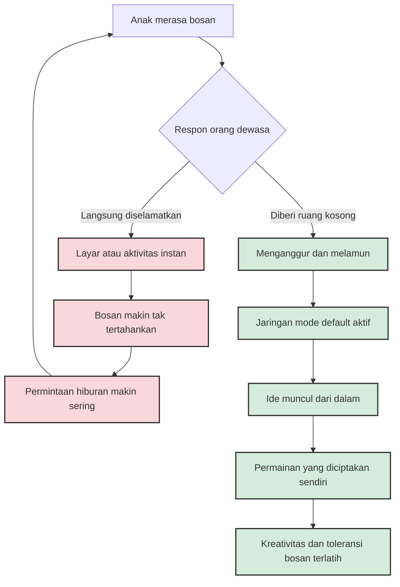

*Kredit foto: david_hwang, Wikimedia Commons, lisensi CC BY 2.0*

Ada satu kata yang membuat tangan orang tua bergerak lebih cepat daripada pikirannya sendiri: "bosan". Begitu kata itu terdengar, refleks kita menyala. HP keluar dari saku, TV menyala, atau kita mulai mengulur menu aktivitas seperti pelayan restoran. Kita memperlakukan kebosanan anak seperti darurat yang harus dibereskan dalam tiga puluh detik, karena rasa tidak nyamannya menular — dan jujur saja, karena kita sendiri tidak tahan mendengarnya.

Padahal kalau kita perhatikan lebih dekat, kebosanan itu bukan kerusakan. Ia lebih mirip rasa lapar: sinyal, bukan penyakit.

## Apa Sebenarnya Bosan Itu

Dalam psikologi, kebosanan didefinisikan oleh Cynthia D. Fisher sebagai keadaan afektif yang tidak menyenangkan dan sementara, di mana seseorang merasa kehilangan minat secara menyeluruh dan sulit memusatkan perhatian pada aktivitas saat itu. Robert Plutchik bahkan menempatkan kebosanan sebagai bentuk ringan dari rasa jijik — respon terhadap sesuatu yang terasa hambar dan tidak bernutrisi bagi pikiran.

Yang menarik, peneliti meyakini kebosanan punya akar evolusi: ia mendorong manusia untuk mencari tantangan baru. Seperti rasa lapar memaksa kita mencari makanan, kebosanan memaksa pikiran mencari makna. Sebelum ada layar, anak yang bosan akan menggulung selimut jadi gua, menyusun kursi jadi kereta, atau menatap langit-langit sampai bayangan di kepalanya mulai bercerita. Kebosanan adalah mesin pencari versi otak — ia menyala justru ketika tidak ada yang bisa dicari di luar sana, sehingga pencariannya berbalik ke dalam.

## Otak yang Tidak Pernah Menganggur

Kita sering menyebut anak yang sedang melamun sedang "tidak melakukan apa-apa". Neurosains justru menunjukkan sebaliknya. Sejak 1929, Hans Berger — penemu elektroensefalografi — sudah membuktikan bahwa osilasi listrik otak tidak pernah berhenti bahkan saat subjek beristirahat. Pada 1950-an, Louis Sokoloff menemukan hal yang membingungkan saat itu: metabolisme otak tidak berubah ketika seseorang beralih dari berdiam diri ke mengerjakan soal matematika yang berat. Otak yang "beristirahat" ternyata bekerja dengan konsumsi energi yang sama besarnya.

Penelitian pencitraan otak modern lalu memetakan aktivitas itu ke satu jaringan yang sekarang dikenal sebagai *default mode network* — jaringan saraf di korteks prefrontal medial, singulate posterior, dan sekitarnya yang justru paling aktif saat kita tidak fokus ke dunia luar: saat melamun, mengenang masa lalu, atau merencanakan masa depan. Jaringan inilah yang membangun narasi diri yang koheren. Ketika anak menatap jendela dengan mata kosong, otaknya sedang mengerjakan pekerjaan rumah yang tidak bisa dikerjakan saat sibuk: merangkai pengalaman hari ini, mencoba-coba identitas, dan menyusun cerita.

Dengan kata lain, melamun bukan kekosongan. Ia ruang kerja.

## Eksperimen Buku Telepon

Bukti paling terkenal tentang hubungan kebosanan dan kreativitas datang dari Sandi Mann dan Rebekah Cadman di University of Central Lancashire. Dalam penelitian yang terbit tahun 2014 di jurnal *Thinking Skills and Creativity*, mereka meminta peserta mengerjakan tugas yang dirancang semembosankan mungkin: menyalin nomor telepon dari buku telepon. Setelah cukup lama berjuang melawan kantuk, peserta diberi tugas kreativitas — membuat daftar kemungkinan kegunaan untuk gelas plastik. Hasilnya, kelompok yang sempat bosan menghasilkan ide lebih banyak dan lebih orisinal dibanding kelompok kontrol.

Interpretasinya masuk akal: pikiran yang terkunci di tugas monoton mencari jalan keluar, dan jalan keluar itu adalah berimajinasi. Wikipedia, merangkum studi-studi semacam ini, mencatat bahwa lingkungan rendah rangsangan dapat meningkatkan kreativitas dan menjadi panggung bagi momen "eureka".

Tapi di sini penting untuk berhenti dan jujur pada data. Filosof Ros Velasco dalam esainya *Contemporary Myths on Boredom* (2023) mengingatkan bahwa klaim "bosan bikin kreatif" sendiri sudah menjadi semacam mitos modern yang terlalu sering dikutip mentah-mentah. Kebosanan tidak otomatis melahirkan apa-apa. Ia bukan mesin juicer yang dituangi rasa hambar lalu keluar ide segar. Kebosanan hanyalah pintu — dan pintu hanya berguna kalau tidak ada yang berdiri di depannya terus-menerus membuka pintu lain yang lebih menghibur.

Anak yang bosan lalu mencari kardus dan mulai membangun, itu kreativitas. Anak yang bosan lalu menatap layar sampai malam, itu pelarian. Rangsangan yang sama, arah yang berbeda. Yang menentukan arahnya adalah seberapa terlatih ia melewati fase tidak nyaman di depan pintu itu.

## Orang Dewasa Saja Tidak Tahan

Masalahnya, kita jarang bisa mencontohkan cara melewatinya. Timothy Wilson dan koleganya dari University of Virginia menerbitkan di *Science* (2014) serangkaian sebelas studi yang hasilnya memalukan sekaligus jujur: kebanyakan partisipan tidak menikmati 6 sampai 15 menit sendirian di ruangan tanpa melakukan apa-apa selain berpikir. Mereka lebih menikmati aktivitas membosankan sekalipun asal ada yang dikerjakan. Dan sebagian dari mereka — dalam salah satu studi, dua pertiga pria dan seperempat wanita — lebih memilih memberikan kejut listrik pada diri sendiri daripada ditinggal sendirian dengan pikirannya.

Kalau orang dewasa lebih memilih setrum daripada diam, heran anak kita begitu piawai menekan tombol power?

Anak-anak masa kini tumbuh di dunia yang rata-rata orang tuanya tidak pernah menyisakan celah kosong. Antrean diisi scroll, lampu merah diisi scroll, jeda percakapan diisi scroll. Penelitian terhadap 642 anak di Negeri Basque, Spanyol (Gaztañaga dkk., 2025), menemukan bahwa anak-anak sendiri menyebut "mengusir kebosanan" sebagai salah satu dari empat manfaat utama smartphone versi mereka — bersanding dengan menjaga koneksi sosial dan mencari informasi. Bagi mereka, layar adalah jawaban baku untuk pertanyaan kosong "sekarang ngapain?"

Sementara itu, meta-analisis terbaru yang menggabungkan 25 studi dengan total 15.152 partisipan (Tagliaferri dkk., 2026) menemukan asosiasi positif moderat antara kebosanan-sebagai-sifat dan penggunaan teknologi digital yang bermasalah (r = 0,38). Arah hubungannya berputar seperti ular memakan ekornya: makin rendah toleransi terhadap bosan, makin sering pelarian ke layar; makin sering pelarian, makin jarang kesempatan melatih toleransinya. Erich Fromm sudah memperingatkan hal ini jauh sebelum smartphone ada: kesibukan mencari hiburan baru dalam budaya konsumsi bukan penyembuhan kebosanan, melainkan sekadar penundaan — kebosanan berlanjut diam-diam di bawah sadar.

## Jadwal yang Penuh Itu Bentuk Lain dari Layar

Layar bukan satu-satunya pencuri ruang kosong. Jadwal juga.

American Academy of Pediatrics dalam laporan klinisnya *The Power of Play* (Yogman dkk., 2018) menyatakan dengan tegas bahwa bermain — khususnya bermain yang tidak diarahkan orang dewasa — adalah kesempatan unik untuk membangun keterampilan sosial-emosional, kognisi, bahasa, dan regulasi diri, sehingga pediatrician disarankan benar-benar menulis "resep bermain" saat kunjungan rutin. Laporan itu lahir karena program pendidikan anak usia dini semakin tertekan menambah komponen akademik dan mengurangi waktu bermain — salah paham bahwa belajar hanya terjadi ketika ada guru, meja, dan lembar kerja.

Peter Gray dalam analisisnya di *American Journal of Play* (2011) menjangkau lebih jauh: selama lima dekade terakhir, waktu bermain bebas anak-anak menurun drastis, dan pada periode yang sama indikator psikopatologi pada anak dan remaja meningkat. Tentu korelasi bukan sebab-akibat, dan Gray sendiri menyebutnya hipotesis. Tapi arah datanya konsisten dengan temuan laboratorium: anak yang tidak pernah diberi kesempatan mengelola waktu kosongnya sendiri tidak pernah membangun otot untuk itu.

## Dua Jalur di Depan Pintu

Seluruh riset di atas sebenarnya bisa diringkas jadi satu percabangan sederhana yang terjadi setiap kali anak berkata bosan:

Jalur merah dan jalur hijau berangkat dari titik yang persis sama. Bedanya cuma satu: berapa lama kita sanggup menahan diri tidak turun tangan.

## Praktiknya di Rumah

*Kredit foto: Shixart1985, Wikimedia Commons, lisensi CC BY 2.0*

Maka praktik pertama dan tersulit: jangan segera menyelamatkan. Ketika anak bilang bosan, kita tidak perlu membalas dengan solusi. Cukup akui perasaannya — "iya, bosan itu memang tidak enak" — lalu biarkan kalimat itu menggantung. Rasa tidak nyaman itu bukan yang harus dihindari; ia justru bahan bakarnya. Kalau kita buru-buru memadamkannya, kita membuang bahan bakarnya juga.

Kedua, pastikan rumah punya bahan-bahan kreativitas tapi tidak punya jadwal untuk menggunakannya. Kardus, kertas, isolasi, crayon, kancing, batu — benda-benda tanpa instruksi. Riset Mann dan Cadman bekerja justru karena pesertanya tidak diberi apa pun selama fase bosan; begitu tugas kreativitas datang, pikiran yang sudah lama mencari jalan keluar langsung menyerapnya. Anak yang tadinya mengeluh bosan dan kini menyusun kardus jadi garasi itu tidak sedang dibandingkan siapa-siapa dan tidak sedang dinilai siapa-siapa — justru itulah kenapa ia bertahan.

Ketiga, jaga agar ada celah di jadwal. Rekomendasi AAP tentang "resep bermain" pada dasarnya adalah resep ruang kosong: blok waktu tanpa kelas, tanpa kursus, tanpa pengawasan ketat. Bagi kita yang kerjanya mengatur tim dan kalender, ini ironi yang terasa — di kantor kita belajar bahwa rapat beruntun membunuh pemikiran mendalam, lalu di rumah kita menjadwalkan anak dari piano ke renang ke koding tanpa jeda.

Keempat — dan ini yang paling menampar — latih diri sendiri dulu. Anak tidak meniru nasihat; mereka meniru kebiasaan. Kalau kita sendiri menunggu anak pulang sekolah sambil scroll, kita sedang mengajar bahwa jeda adalah masalah yang harus diisi.

Terakhir, bedakan bosan sementara dengan bosan kronis. Yang pertama subur. Yang kedua adalah data: riset pendidikan menunjukkan kebosanan di kelas bisa berarti materi terlalu sulit — atau terlalu mudah. Anak yang bosan terus-menerus di lingkungan yang sama, dalam durasi panjang, dan disertai lesu, itu bukan kekurangan layar melainkan sinyal lingkungan yang perlu dibaca lebih serius.

## Menyisakan Waktu yang Tidak Diisi

Blaise Pascal menulis di *Pensées* bahwa manusia mencari pergumulan dengan berbagai rintangan, dan begitu rintangan itu teratasi, justru istirahat itu tak tertahankan karena kebosanan yang ditimbulkannya. Hampir empat ratus tahun sebelum Wilson menyetrum partisipannya, Pascal sudah tahu: yang kita lari bukan kekosongannya, tapi ketidakmampuan kita menemani diri sendiri di dalamnya.

Sebagai ayah, saya pun tidak istimewa di urusan ini — refleks menyelamatkan itu hidup juga di tangan saya. Tapi riset-riset di atas meyakinkan saya bahwa salah satu warisan paling berharga yang bisa saya berikan bukan jadwal yang seru atau hiburan yang lengkap, melainkan kemampuan duduk tenang di dalam waktu yang tidak diisi — karena hidup, seberapa pun sucinya usaha kita menyusunnya, akan selalu menyisakan waktu kosong. Anak yang tahu apa yang harus dilakukan dengan waktu kosongnya tidak akan pernah benar-benar kosong.

## Referensi

1. Mann, S., & Cadman, R. (2014). *Does being bored make us more creative?* Thinking Skills and Creativity, Vol. 12, hlm. 11–19. — Eksperimen penyalinan buku telepon dan tugas kreativitas gelas plastik.
2. Wilson, T. D., Reinhard, D. A., Westgate, E. C., Gilbert, D. T., dkk. (2014). *Just think: The challenges of the disengaged mind.* Science, 345(6192), 75–77. PMID: 24994650. — 11 studi; banyak partisipan memilih kejut listrik daripada sendirian dengan pikirannya.
3. Gaztañaga, M., Idoiaga-Mondragon, N., Legorburu Fernandez, I., & Eiguren Munitis, A. (2025). *Smartphones through children's eyes: perceived benefits and educational considerations.* Frontiers in Psychology, 16:1596595. PMID: 40612992.
4. Tagliaferri, G., Hidalgo-Fuentes, S., Frisari, F. V., Cricenti, C., & Martí-Vilar, M. (2026). *Trait Boredom and Problematic Use of New Technologies: A Meta-Analysis.* Psychological Reports. PMID: 42285161.
5. Ros Velasco, J. (2023). *Contemporary myths on boredom.* Frontiers in Sociology, 8:1183875. PMID: 37350852.
6. Yogman, M., Garner, A., Hutchinson, J., Hirsh-Pasek, K., & Golinkoff, R. M. (2018). *The Power of Play: A Pediatric Role in Enhancing Development in Young Children.* Pediatrics, 142(3):e20182058. PMID: 30126932.
7. Gray, P. (2011). *The Decline of Play and the Rise of Psychopathology in Children and Adolescents.* American Journal of Play, 3(4), 443–463.
8. Wikipedia. *Boredom* dan *Default mode network* — definisi kebosanan (Fisher; Plutchik), akar evolusioner, sejarah penelitian otak saat istirahat (Berger; Sokoloff), serta pemikiran Pascal dan Fromm. (Diakses Oktober 2026.)
