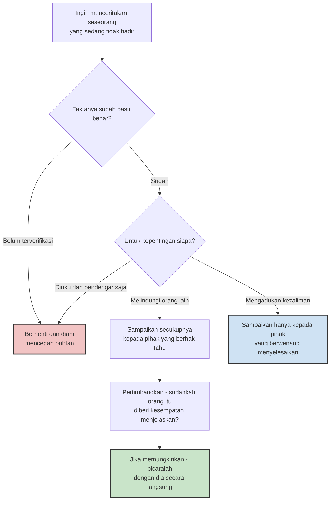

*Kredit foto: Kayla Kay, Wikimedia Commons, CC BY 2.0*

Pada akhir 2019, dua peneliti psikologi dari University of California, Riverside, menerbitkan studi dengan metode yang nyaris tidak pernah dilakukan sebelumnya: alih-alih bertanya "seberapa sering Anda bergosip?", mereka memasang perekam suara kecil pada 467 partisipan dan membiarkan alat itu merekam cuplikan percakapan mereka sepanjang hari. Bukan survei yang bisa dijawab dengan rasa malu atau pencitraan diri — melainkan suara mereka sendiri, apa adanya. Hasilnya: rata-rata orang menghabiskan sekitar 52 menit setiap hari untuk membicarakan orang yang tidak sedang hadir. Dan sebagian besar dari gosip itu tergolong netral — bukan pujian, bukan penghinaan, hanya pertukaran informasi tentang hidup orang lain (Robbins & Karan, 2020).

Angka itu penting bukan karena besar, melainkan karena biasa. Gosip jarang datang sebagai kejahatan yang direncanakan. Ia datang mengikuti ritme percakapan sehari-hari: obrolan sembari menunggu rapat dimulai, komentar singkat di meja makan, cerita yang diteruskan di grup keluarga. Persis karena terasa normal, ia hampir tidak pernah dihitung sebagai dosa oleh pelakunya — termasuk oleh saya. Wilayah lisan yang paling sering saya langgar justru wilayah yang terasa paling tidak berbahaya.

## Ketika yang dibicarakan tidak bisa membela diri

Suatu hari Rasulullah shallallahu 'alaihi wasallam bertanya kepada para sahabat, "Tahukah kalian apa ghibah itu?" Mereka menjawab, "Allah dan Rasul-Nya yang lebih tahu." Beliau bersabda: "Engkau menyebutkan saudaramu dengan sesuatu yang ia benci." Para sahabat melanjutkan, "Bagaimana jika yang saya katakan memang benar ada pada dirinya?" Beliau menjawab, "Jika memang benar ada padanya, engkau telah menggunjingnya. Dan jika tidak ada padanya, engkau telah memfitnahnya." (HR Muslim no. 2589)

Definisi ini presisi dengan cara yang sering terlewat. Ghibah tidak didefinisikan sebagai berita bohong. Definisinya adalah menyebutkan sesuatu yang dibenci si subjek — dan tolok ukurnya bukan niat pembicara, bukan pula rasa penasaran pendengar, melainkan perasaan orang yang dibicarakan. Kalau beritanya dusta, pelakunya tidak sekadar menggunjing; ia sudah naik kelas ke buhtan, fitnah yang lebih berat. Maksudnya jelas: kebenaran informasi bukan izin untuk menyebarkannya.

Al-Quran kemudian memperkuat larangan ini dengan salah satu perumpamaan yang paling menusuk:

> "Hai orang-orang yang beriman, jauhilah kebanyakan purba-sangka (kecurigaan), karena sebagian dari purba-sangka itu dosa. Dan janganlah mencari-cari keburukan orang dan janganlah menggunjingkan satu sama lain. Adakah seorang di antara kamu yang suka memakan daging saudaranya yang sudah mati? Maka tentulah kamu merasa jijik kepadanya." (QS Al-Hujurat [49]: 12)

Perumpamaan ini bekerja karena tiga lapisannya saling mengunci. Yang dibicarakan itu *saudara* — jadi yang diserang adalah orang yang punya hak atas kita. Ia seperti *mayat* — tidak hadir, tidak bisa membela diri, tidak tahu sedang dijadikan bahan percakapan. Dan kita *memakannya* — ada kenikmatan yang kita ambil dari situ: kenikmatan merasa lebih baik, kehangatan kebersamaan dengan pendengar, atau sekadar kepuasan tahu sesuatu yang orang lain belum tahu. Ayat ditutup dengan refleks yang paling fisik: rasa jijik. Seolah-olah Allah memakai reaksi biologis kita sendiri sebagai guru moral — kalau memakan bangkai saudara membuatmu muak, mengapa memakan reputasinya tidak?

Dalam riwayat lain skala masalahnya dibuat semakin telanjang. Aisyah bercerita, ia pernah menyebut kekurangan fisik seorang wanita di hadapan Rasulullah dengan satu kalimat singkat. Jawabannya: "Sungguh engkau telah mengucapkan satu kalimat yang seandainya dicampurkan ke lautan, niscaya mencemarkannya." (HR Abu Dawud no. 4875) Satu kalimat, satu samudra. Ketidakseimbangan skala inilah yang membuat ghibah sulit kita nilai dengan benar: dari sisi pembicara ia terasa sepele, dari sisi efeknya ia tidak pernah sekecil itu.

## Bagian yang membuat tidak nyaman: sains justru menemukan fungsinya

Insting pertama kita menganggap gosip sebagai kebiasaan buruk yang tidak menyisakan apa pun selain kerusakan. Riset dua dekade terakhir menunjukkan gambaran yang lebih rumit — dan di sinilah artikel ini jadi menarik untuk saya tulis.

Antropolog Robin Dunbar dalam *Grooming, Gossip, and the Evolution of Language* (1996) mengajukan gagasan bahwa bahasa manusia berkembang sebagai pengganti efisien dari aktivitas primata saling menyisir bulu — ritual yang membangun dan merawat ikatan. Jejaring sosial manusia tumbuh terlalu besar untuk dirawat dengan sentuhan fisik, maka kita merawatnya dengan percakapan; dan sebagian besar percakapan itu, secara alami, tentang orang ketiga. Gosip dalam kerangka ini adalah perekat sosial.

Lebih tajam lagi, Matthew Feinberg dan koleganya di UC Berkeley (2012) melakukan empat eksperimen tentang apa yang mereka sebut *prosocial gossip*. Orang yang menyaksikan perilaku egois mengalami perasaan negatif dan terdorong memberi tahu orang lain yang berpotensi menjadi korban — bahkan ketika itu merugikan kepentingan mereka sendiri. Dalam permainan ekonomi, sekadar kemungkinan akan digosipkan cukup membuat orang mengurangi keegoisan dan meningkatkan kerja sama. Gosip, kata mereka, adalah cara masyarakat menjaga akuntabilitas.

Studi yang paling dekat dengan hidup sehari-hari datang dari Dores Cruz dan sepuluh koleganya (2021): 309 orang di komunitas Belanda mencatat kejadian gosip selama sepuluh hari — total 5.284 kejadian. Temuan yang paling mencolok ada di sisi penerima: mereka *secara konsisten memercayai* gosip yang mereka terima, lalu memperbarui penilaian mereka terhadap orang yang dibicarakan, yang kemudian mengubah niat mereka untuk membantu atau menghindari orang itu di interaksi berikutnya. Reputasi dibangun dan dibongkar dalam percakapan tentang orang yang tidak hadir — hampir tanpa verifikasi.

Terakhir, ada temuan yang membuat kombinasi di atas jadi berbahaya. Menganalisis sekitar 126.000 cerita yang beredar di Twitter, Vosoughi, Roy, dan Aral (2018) menemukan bahwa kebohongan menyebar lebih cepat, lebih jauh, dan lebih dalam daripada kebenaran — sebuah berita palsu sekitar 70% lebih mungkin disebar ulang. Nah, sambungkan: penerima gosip cenderung langsung percaya, dan kebohongan menyebar lebih cepat daripada bantahan. Ghibah, apalagi yang berisi informasi tak terverifikasi, adalah mesin reputasi yang berputar kencang tanpa rem.

Jadi sains bilang gosip itu fungsional, dan Islam melarangnya keras. Kontradiksi? Tidak. Yang perlu dipisahkan adalah *fungsi* dari *bentuk* — dan di sinilah kedalaman aturan Islam jadi terlihat.

## Fungsi bukan izin: garis yang sebenarnya

Ulama tidak pernah menyatakan semua aliran informasi tentang orang lain haram. Imam an-Nawawi dalam syarahnya atas Shahih Muslim mencatat pengecualian yang sudah mafhum: mengadukan kezaliman kepada pihak yang berwenang, meminta bantuan untuk mengubah kemungkaran, meminta fatwa, memperingatkan sesama muslim dari bahaya nyata — misalnya saat seseorang hendak bertransaksi atau menikah dengan orang yang bermasalah — menyebut identitas seseorang yang memang sudah dikenal umum dengan sebutan tertentu, dan menyebut dosa yang pelakunya sendiri terang-terangan memamerkannya.

Perhatikan polanya: dalam setiap pengecualian, informasi mengalir karena ada pihak yang *berhak tahu* dan ada kepentingan yang dilindungi — bukan karena obrolannya seru. Menariknya, ini hampir persis definisi "gosip prososial" ala Feinberg: informasi negatif dibagikan bukan untuk hiburan, melainkan untuk melindungi calon korban. Dengan bahasa sekarang: aturan Islam 14 abad lalu sudah membedakan *whistleblowing* dari obrolan kosong — pemberitahuan untuk perlindungan versus percakapan untuk kesenangan.

Yang membedakan keduanya bukan isi informasinya, melainkan dua pertanyaan: apakah orang yang dibicarakan berkepentingan untuk tidak dibicarakan, dan apakah pendengar benar-benar berkepentingan untuk tahu. Definisi hadits tadi — "sesuatu yang ia benci" — menempatkan hak veto pada orang yang dibicarakan, bukan pada niat baik kita. Sebuah informasi bisa benar, bisa berguna bagi kita, dan tetap bukan milik kita untuk dibagikan.

## Di tempat kerja: gosip sebagai data, bukan sekadar gangguan

Bagi saya yang setiap hari bekerja bersama tim, bagian ini yang paling terasa. Peneliti rumor Nicholas DiFonzo dan Prashant Bordia mencatat bahwa gosip di organisasi memiliki fungsi nyata: membantu orang mempelajari informasi sosial, menegakkan norma, dan membangun rasa memiliki. Artinya, gosip kantor tidak akan pernah bisa — dan mungkin tidak perlu — dihapus total. Yang bisa diubah adalah arah alirannya.

Ada satu pertanyaan yang menurut saya paling penting diajukan pemimpin ketika obrolan tentang seseorang beredar di belakang: bukan "siapa yang memulai?", melainkan "mengapa ini tidak bisa dibicarakan di depan?". Riset tentang keselamatan psikologis dari Amy Edmondson menunjukkan bahwa tim tampil terbaik justru ketika anggotanya berani berbicara langsung — memberi umpan balik, mengakui kesalahan, menyampaikan keberatan — tanpa rasa takut. Tim yang sehat menuntaskan urusannya *melalui* orangnya, bukan menggiringnya *di sekelilingnya*. Gosip yang terus beredar sering kali bukan penyakit, melainkan gejala: saluran resmi untuk bicara jujur tersumbat, maka percakapan mencari jalan bawah tanah.

Praktiknya bisa sekecil dua kalimat. Ketika seseorang mulai bercerita panjang tentang kejanggalan perilaku rekan kerjanya, saya mencoba menahan diri untuk tidak sekadar jadi pendengar yang antusias, lalu bertanya: "Sudahkah kamu sampaikan langsung ke dia? Kalau susah, mau saya bantu memfasilitasi?" Kalimat pertama mengalihkan masalah ke pemiliknya; kalimat kedua menawarkan jalan resmi. Dan satu hal yang perlu dijaga pemimpin: jangan pernah menjadikan gosip sebagai kanal informasi resmi. Setiap kali kita mengambil keputusan tentang seseorang berdasarkan cerita orang ketiga tanpa pernah memverifikasi ke orangnya, kita sedang mengajari satu hal ke seluruh tim — bahwa bicara di belakang lebih aman daripada bicara di depan.

## Filter kecil sebelum mulai bicara

Semua di atas bisa dipadatkan menjadi satu instruksi yang Rasulullah ringkas dalam tiga kata: "Hendaklah ia berkata baik atau diam." (HR Bukhari no. 6018) Diam adalah keadaan default; berbicara adalah pengecualian yang butuh alasan. Untuk praktik sehari-hari, saya menyusun alurnya menjadi diagram sederhana yang bisa saya ingat sebelum mulai menceritakan seseorang:

Diam bukan berarti pasif soal keburukan. Diagram di atas justru punya jalur untuk bicara — tetapi jalur itu selalu melewati dua gerbang: verifikasi dan kepentingan. Di luar dua gerbang itu, 52 menit sehari kita tentang orang lain lebih baik diisi dengan yang lain.

## Penutup kecil yang jujur

Para ulama salaf menyebut penjagaan lisan sebagai bagian dari puasa yang paling sulit — puasa lidah, yang tidak berhenti di magrib. Saya mengerti mengapa. Ghibah adalah dosa yang menyamar sebagai kebersamaan; ia terasa seperti keintiman, padahal kehangatannya dibangun di atas sesuatu yang bukan milik kita. Dan justru karena paling nikmat, ia paling sulit ditinggalkan.

Maka target saya sederhana, dan mungkin Anda juga: kurangi sedikit dari 52 menit itu, mulai dari percakapan paling santai berikutnya. Bukan karena gosip tidak berfungsi — ia berfungsi, dan itu justru masalahnya — melainkan karena reputasi saudara kita adalah amanah yang tidak boleh kita makan.

## Referensi

1. Robbins, M. K., & Karan, A. (2020). *Who Gossips and How Often in Everyday Life?* Social Psychological and Personality Science. DOI: 10.1177/1948550619899608
2. Feinberg, M., Willer, R., Stellar, J., & Keltner, D. (2012). *The Virtues of Gossip: Reputational Information Sharing as Prosocial Behavior.* Journal of Personality and Social Psychology, 102(5), 1015–1030. DOI: 10.1037/a0026650
3. Dores Cruz, T. D., dkk. (2021). *Gossip and Reputation in Everyday Life.* Philosophical Transactions of the Royal Society B, 376(1838), 20200301. DOI: 10.1098/rstb.2020.0301
4. Vosoughi, S., Roy, D., & Aral, S. (2018). *The Spread of True and False News Online.* Science, 359(6380), 1146–1151. DOI: 10.1126/science.aap9559
5. Dunbar, R. I. M. (1996). *Grooming, Gossip, and the Evolution of Language.* Faber and Faber / Harvard University Press.
6. QS Al-Hujurat [49]: 11–12, terjemahan Kementerian Agama RI (via alquran.cloud).
7. HR Muslim no. 2589 (definisi ghibah) — sunnah.com/muslim:2589; HR Abu Dawud no. 4875 — sunnah.com/abudawud:4875; HR Bukhari no. 6018 — sunnah.com/bukhari:6018.
8. Imam an-Nawawi, *Syarh Shahih Muslim*, bab larangan ghibah (pengecualian ghibah yang diperbolehkan).
9. Wikipedia, *Gossip* (fungsi gosip di tempat kerja menurut DiFonzo & Bordia) — en.wikipedia.org/wiki/Gossip
