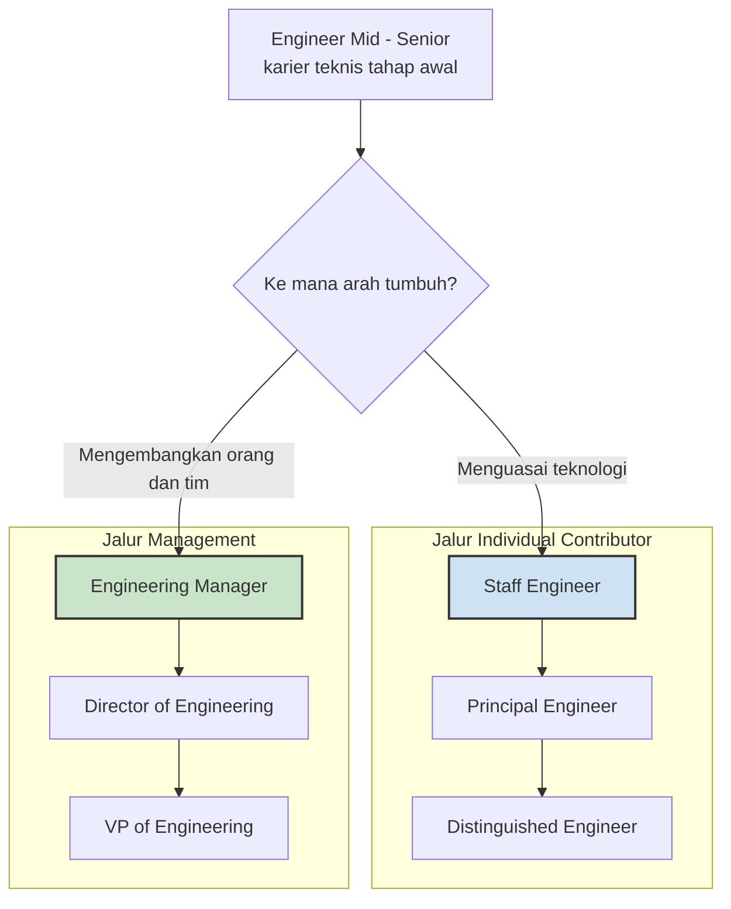

*Kredit foto: Basile Morin, Wikimedia Commons, CC BY-SA 4.0*

Tahun 1910, lebih dari setengah abad sebelum konsep manajemen modern mewarnai rak-rak buku, filsuf Spanyol José Ortega y Gasset menulis kalimat yang terdengar seperti lelucon pahit: semua pegawai publik sebaiknya diturunkan ke tingkat di bawah posisinya saat ini, karena mereka justru dipromosikan berulang kali hingga menjadi tidak kompeten. Lima puluh sembilan tahun kemudian, gagasan itu menemukan bentuk finalnya. Dalam buku *The Peter Principle* (1969), Laurence J. Peter dan Raymond Hull merumuskannya sebagai hukum yang tampaknya tak terbantahkan: dalam sebuah hierarki, setiap karyawan cenderung naik hingga mencapai tingkat ketidakkompetenannya sendiri.

Buku itu aslinya ditulis sebagai satir. Peter dan Hull memanggil bidang kajian mereka "hierarkiologi" dan menggoda pembaca dengan istilah-istilah jenaka seperti *percussive sublimation* — dipromosikan ke atas hanya untuk disingkirkan dari jalur kerja nyata. Tapi satir itu bertahan puluhan tahun justru karena menjelaskan sesuatu yang terasa benar di hampir semua organisasi. Mekanismenya sederhana dan kejam sekaligus: selama seseorang kompeten, ia dipromosikan lagi. Begitu ia mencapai posisi yang tidak bisa ia jalani, promosi berhenti — dan di situlah ia tertahan, di apa yang disebut *Peter's plateau*. Level akhir setiap orang, hampir secara definisi, adalah level di mana ia tidak lagi baik dalam pekerjaannya.

Yang mengejutkan, kecurigaan ini jauh lebih tua dari bukunya. Dalam drama *Minna von Barnhelm* tahun 1763, dramawan Jerman Gotthold Ephraim Lessing menggambarkan seorang sersan yang menolak kesempatan naik pangkat dengan alasan yang terdengar sangat modern: "Saya sersan yang baik; saya bisa dengan mudah menjadi kapten yang buruk, dan tentu jenderal yang lebih buruk lagi. Semua orang tahu dari pengalaman." Karl von Clausewitz, teoretikawan perang abad ke-19, mengamati hal serupa: tidak ada yang lebih umum daripada melihat orang kehilangan energi mereka setelah dinaikkan ke posisi yang tidak mereka rasakan setara dengannya. Artinya, dua abad sebelum ada riset manajemen, orang-orang yang bekerja di hierarki ketat — militer — sudah memahami bahwa keterampilan tidak otomatis terbawa naik bersama pangkat.

## Mengapa rekayasa software adalah habitat ideal

Industri software mungkin salah satu habitat paling subur untuk prinsip ini. Alasannya: keterampilan yang membuat seorang engineer luar biasa hampir tegak lurus terhadap keterampilan yang dibutuhkan seorang manajer engineering. Kedalaman teknis, kemampuan fokus berjam-jam pada satu masalah sulit, dan dorongan menyelesaikan sesuatu dengan tangannya sendiri adalah otot yang menajamkan seorang *individual contributor*. Sementara itu, manajemen bekerja dengan otot yang berbeda: coaching, komunikasi lintas fungsi, membaca dinamika tim, memberi umpan balik yang sulit, dan menahan diri untuk tidak ikut menulis kode ketika seharusnya mendelegasikan.

Ketika promosi diperlakukan sebagai hadiah atas dedikasi — "dia engineer terbaik kita, sudah waktunya jadi manager" — organisasi sesungguhnya sedang memperlakukan manajemen sebagai trofi, bukan sebagai profesi. Dan profesinya memang berbeda. Scott Adams, pencipta strip komik Dilbert, bahkan membalik logikanya dalam *Dilbert principle* (1996): perusahaan mempromosikan orang yang paling tidak kompeten ke posisi manajemen justru supaya mereka keluar dari alur kerja produktif — "orang pintar Anda, pembedah jantung dan pemrogram Anda, tidak ada yang di manajemen," tulisnya. Dua lelucon dari dua arah berlawanan, satu diagnosis yang sama: tangga karier satu arah yang buntu di atas.

Yang membuat ini mahal khususnya di software: engineer terbaik biasanya juga jaring pengaman bagi orang lain. Ia yang paling sering dijadikan tempat bertanya, paling cepat meninjau *pull request* orang lain, paling dipercaya saat sistem produksi bermasalah. Memindahkannya ke kursi manajemen dengan persiapan minim berarti menghapus tiga peran sekaligus — penulis kode, peninjau, dan mentor — lalu berharap ia mengganti semua itu dengan keterampilan yang belum pernah ia latih. Beberapa orang berhasil melakukan lompatan itu; banyak yang tidak; dan hampir semua butuh tahun untuk menyadarinya karena tidak ada yang ingin mengakui bahwa promosi ternyata merugikan semua pihak.

## Ternyata bukan sekadar lelucon

Kalau ini cuma humor ruang istirahat, mudah untuk membiarkannya. Tapi riset ekonomi dan komputasi menunjukkan mekanismenya nyata. Ekonom Edward Lazear dari Stanford (2000) menjelaskan bahwa prinsip Peter muncul sebagai proses statistik yang hampir tak terhindarkan: orang dipromosikan karena melewati tolok ukur kinerja tertentu, padahal komponen yang mendorong tolok ukur itu — keberuntungan, momen yang pas, kecocokan peran — tidak selalu bisa direplikasi di peran berikutnya.

Yang lebih mengguncang adalah simulasi komputasi Alessandro Pluchino, Andrea Rapisarda, dan Cesare Garofalo yang terbit di jurnal *Physica A* (2010). Menggunakan pemodelan berbasis agen, mereka mensimulasikan perusahaan yang menerapkan berbagai strategi promosi. Hasilnya: strategi "selalu promosikan karyawan terbaik" — strategi yang dipakai hampir semua perusahaan — menghasilkan efisiensi organisasi paling buruk. Promosi yang dilakukan *secara acak*, atau membuat daftar pendek berisi karyawan terbaik dan terburuk lalu memilih satu secara acak, justru menghasilkan organisasi yang lebih efektif. Karya ini mendapat Ig Nobel Prize 2010 untuk ilmu manajemen — penghargaan parodi yang secara resmi diberikan kepada riset yang "membuat orang tertawa, lalu berpikir".

Lalu ada bukti dari data lapangan. Alan Benson, Danielle Li, dan Kelly Shue menganalisis kinerja dan praktik promosi tenaga penjualan di 214 perusahaan Amerika (NBER Working Paper 24343, 2018). Temuan mereka dua sisi dan keduanya menyakitkan: perusahaan cenderung mempromosikan orang berdasarkan kinerja di posisi lamanya, bukan berdasarkan potensi manajerialnya — dan penjual dengan kinerja terbaik justru lebih mungkin tampil buruk setelah menjadi manajer. Performa dan potensi adalah dua variabel berbeda, dan organisasi yang mengacaukan keduanya membayar harganya dua kali: kehilangan producer terbaiknya sekaligus mendapat manajer yang berjuang.

Ada juga dimensi manusiawi yang sering luput: apa yang dilakukan orang sehat ketika sistem hanya menawarkan satu jenis hadiah berbahaya. Peter dan Hull menyebutnya *creative incompetence* — strategi orang-orang yang secara sengaja menampilkan kelemahan kecil yang tidak mengganggu pekerjaannya, semata-mata agar namanya keluar dari daftar kandidat promosi. Di permukaan ini tampak seperti keanehan, tetapi sebenarnya respons yang sangat rasional terhadap desain insentif yang rusak. Ketika satu-satunya cara "naik" adalah pindah ke peran yang tidak diinginkan, orang yang paling menghargai pekerjaannya sendiri akan belajar bersembunyi dari penghargaan. Organisasi yang membuat orang takut dipromosikan sedang menyia-nyiakan sinyal paling jujur yang dimilikinya.

## Tangga yang bercabang: jawaban yang sudah lama ada

Solusi atas masalah ini sebenarnya sudah dirumuskan jauh sebelum industri software ada, dalam konsep *dual career ladder* — jalur karier ganda yang memungkinkan karyawan naik lewat jalur supervisori maupun jalur teknis. Sebagaimana dirangkum Wikipedia, program semacam ini umum di industri engineering, sains, dan medis, tempat karyawan berharga memiliki keahlian teknis khusus tetapi tidak berminat menempuh jalur manajemen. Bila dikelola dengan benar, dua jalur ini membantu perusahaan mempertahankan talenta terbaiknya sambil tetap membuka ruang kenaikan penghasilan.

Dalam praktik teknologi modern, bentuknya kira-kira seperti ini: Will Larson, dalam proyek *Staff Engineer* di staffeng.com, mengamati bahwa di kebanyakan perusahaan teknologi seseorang mencapai level Senior Software Engineer — *career level* — dalam lima sampai delapan tahun. Sebutan "career level" itu penting: senior adalah level tempat organisasi mengatakan "kamu sudah cukup baik, dan tidak ada kewajiban untuk terus naik." Setelah titik itu jalurnya bercabang: masuk ke engineering management, atau melanjutkan jalur keunggulan teknis menuju Staff Engineer, lalu Principal, lalu Distinguished. Yang menarik, Larson mencatat bahwa peta untuk jalur manajemen kian lengkap — buku seperti *The Manager's Path* (Camille Fournier) dan *The Making of a Manager* (Julie Zhuo) kini mudah ditemukan — sementara transisi menuju peran Staff tetap "sangat menantang dan tidak terdokumentasi". Karena itu ia mengumpulkan cerita para Staff dan Principal Engineer agar orang lain bisa menggambar petanya sendiri.

Inti dari jalur Staff ke atas bukan sekadar gelar yang lebih panjang. Yang berubah adalah cara seseorang memberi pengaruh: tanpa otoritas langsung atas orang lain, seorang Staff Engineer bekerja lewat arsitektur, mentoring, arah teknis, dan kepercayaan. Jalur manajemen bekerja lewat sistem yang berbeda — tim, proses, keputusan orang. Keduanya sah, keduanya sulit, dan keduanya sama-sama "naik" bila organisasi benar-benar menghargai keduanya.

## Ketika tangga ganda cuma jadi pajangan

Di sinilah banyak organisasi gagal diam-diam. Jalur ganda yang tidak disertai paritas nyata — gaji yang setara, akses ke keputusan yang setara, rasa hormat yang setara — bukan dual ladder, melainkan apa yang oleh Peter dan Hull diejek sebagai *lateral arabesque*: dipindah ke pinggiran dengan jabatan yang terdengar lebih megah. Bila satu-satunya cara mendapat kenaikan penghasilan adalah mengelola orang, maka orang-orang yang sebenarnya ingin mendalami teknologi akan mengambil kursi manajemen dengan setengah hati. Hasilnya dua kerugian sekaligus: tim kehilangan kode dari engineer terbaiknya, dan mendapat manajer yang hatinya tetap di editor.

Beberapa hal praktis bisa dilakukan pemimpin engineering agar bercabangnya jalur ini sungguh berarti. Rubrik promosi ke manajemen perlu menilai sinyal manajerial — mentoring, kualitas komunikasi, keputusan yang diambil untuk tim — bukan output individual semata, persis pelajaran dari data Benson dan koleganya. Percobaan dua arah juga menolong: rotasi menjadi tech lead, atau masa interim sebagai manajer dengan pintu kembali ke jalur IC yang terbuka lebar dan tanpa rasa malu. Pindah jalur harus dipandang sebagai informasi, bukan kegagalan. Cara organisasi mengevaluasi manajernya juga ikut menentukan: manajer yang diukur dari sisa output individualnya akan terus merasa harus ikut menulis kode, sedangkan manajer yang diukur dari pertumbuhan dan hasil timnya belajar cepat bahwa pekerjaannya bukan lagi menumpuk commit pribadi. Dan percakapan karier perlu bertanya arah, bukan sekadar kesiapan: apakah energinya muncul saat mengembangkan orang, atau saat menguasasi teknologi? Pertanyaan itu sederhana, tetapi menjawabnya dengan jujur bisa menghemat bertahun-tahun kehidupan profesional.

Sebagai orang yang menempuh jalur manajemen, saya makin sadar kursi ini adalah profesi tersendiri, bukan garis akhir dari profesi sebelumnya — dan menghormati rekan yang memilih kedalaman teknis adalah bagian dari pekerjaan saya. Larson juga menulis sesuatu yang berkesan di salah satu panduannya: semakin senior peran seseorang, ekspektasi dampaknya terus naik justru ketika waktu yang tersedia menyusut, sehingga kunci keberlanjutan karier adalah mengatur ritme karier sesuai ritme hidup. Bagi saya yang juga seorang ayah, kalimat itu menusuk lebih dalam daripada gelar apa pun di ujung tangga.

Ortega y Gasset menawarkan solusi lelucon: turunkan semua orang satu tingkat. Solusi yang lebih masuk akal tidak perlu sedrastis itu — cukup bangun dua tangga yang sama kokohnya, satu untuk mereka yang ingin mengelola, satu untuk mereka yang ingin mendalami, dan pastikan keduanya benar-benar bisa dipanjat. Organisasi yang paham ini berhenti menukar engineer terbaiknya dengan jabatan yang salah bentuk, dan para engineer terbaiknya berhenti dihukum oleh kesuksesannya sendiri.

## Referensi

1. Peter, Laurence J. & Raymond Hull — *The Peter Principle* (William Morrow, 1969); ringkasan dan konteks riset di Wikipedia: [Peter principle](https://en.wikipedia.org/wiki/Peter_principle)
2. Benson, Alan; Li, Danielle; Shue, Kelly — *Promotions and the Peter Principle*, NBER Working Paper 24343 (2018), DOI 10.3386/w24343 — [nber.org/papers/w24343](https://www.nber.org/papers/w24343)
3. Pluchino, A.; Rapisarda, A.; Garofalo, C. — *The Peter Principle Revisited: A Computational Study*, Physica A 389(3), 2010, hlm. 467–472, DOI 10.1016/j.physa.2009.09.045
4. Lazear, Edward P. — *The Peter Principle: Promotions and Declining Productivity* (2000), Hoover Institution & Stanford Graduate School of Business
5. Wikipedia — [Career ladder](https://en.wikipedia.org/wiki/Career_ladder), bagian *Dual career ladder*
6. Larson, Will — *Staff Engineer: Leadership beyond the management track* — [staffeng.com](https://staffeng.com/)
7. Wikipedia — [Dilbert principle](https://en.wikipedia.org/wiki/Dilbert_principle), termasuk kutipan Scott Adams
