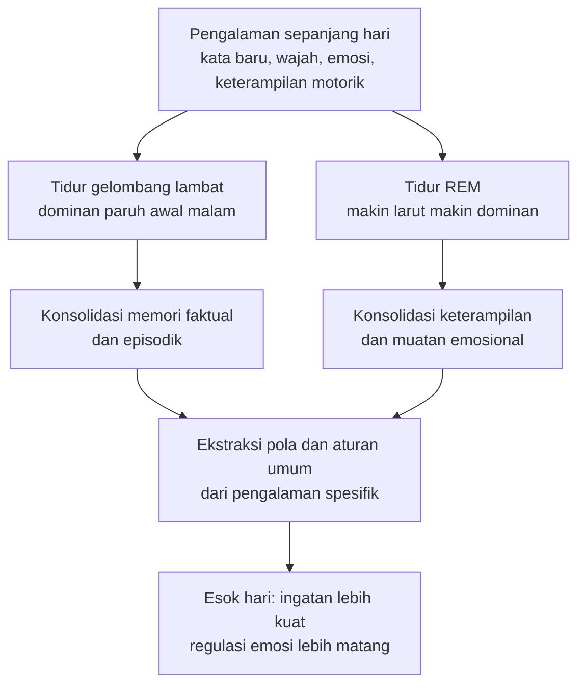

*Kredit foto: Lewis Wickes Hine, koleksi National Child Labor Committee, Library of Congress — domain publik*

Kita biasa memperlakukan tidur anak sebagai jeda. Waktu ketika pembelajaran berhenti, ketika tubuh sekadar mengisi ulang baterai, sehingga jam tidur menjadi variabel pertama yang dengan mudah dikorbankan — satu video lagi, satu acara keluarga lagi, "yang penting anaknya senang". Anggapan itu masuk akal jika tidur memang mode diam. Tetapi dua puluh tahun terakhir penelitian neurosains menunjukkan gambaran yang berlawanan: bagi otak yang sedang tumbuh, malam hari bukan jeda, melainkan shift kerja kedua. Dan yang dikerjakan di shift itu bukan pekerjaan kecil.

Sebagian besar hal yang paling menentukan perkembangan anak — konsolidasi memori, ekstraksi pola bahasa, regulasi emosi, bahkan sekresi hormon pertumbuhan — mencapai puncaknya justru ketika anak tidak sedang melakukan apa-apa. Artikel ini mengupas apa yang sebenarnya terjadi di balik kelopak mata yang tertutup, dan mengapa keputusan sepele soal jam tidur mungkin adalah salah satu keputusan pengasuhan dengan dampak terbesar.

## Malam Adalah Shift Kedua

Tidur bukan satu kondisi seragam. Semalaman, otak berputar melalui siklus kira-kira sembilan puluh menit yang bergantian antara tidur non-REM — terutama tidur gelombang lambat yang dalam — dan tidur REM, fase ketika mimpi paling hidup terjadi. Keduanya punya spesialisasi yang berbeda. Artikel Wikipedia tentang *sleep and learning* merangkum pembagian kerjanya: tidur gelombang lambat berperan besar dalam konsolidasi memori deklaratif — fakta, peristiwa, nama, pengalaman yang bisa diceritakan — sedangkan REM lebih terkait dengan memori implisit dan prosedural, keterampilan yang kita kuasai tanpa perlu berpikir langkah demi langkah.

Yang lebih menarik adalah apa yang dilakukan tidur terhadap materi mentah pengalaman. Membaca berbagai temuan di bidang ini, tidur tidak sekadar "menyimpan" memori seperti memindahkan berkas ke hard disk. Otak yang tidur menyuntingnya — mencari pola penting, mengekstraksi aturan umum dari rangkaian peristiwa spesifik, lalu mengintegrasikannya dengan pengetahuan yang sudah ada. Ada hipotesis yang disebut *synaptic scaling*: tidur menurunkan skala kekuatan seluruh sinapsis secara proporsional, sehingga sinyal yang benar-benar penting menonjol dan ruang serta energi otak terpakai lebih efisien. Seperti editor yang mengerjakan draf mentah menjadi naskah final, tidur mengubah pengalaman hari itu menjadi sesuatu yang bisa dipakai esok hari.

Pada anak, shift kedua ini bahkan lebih sibuk daripada pada orang dewasa. Tidur gelombang lambat dan REM menempori porsi jauh lebih besar di awal kehidupan — tepat pada periode ketika volume pembelajaran juga paling tinggi. Ditambah satu fakta fisiologis klasik: sebagian besar sekresi hormon pertumbuhan harian terjadi pada fase gelombang lambat. Anak bertambah tinggi secara harfiah di malam hari.

## Bayi yang Tertidur Justru Sedang Belajar Tata Bahasa

Bukti paling elegan soal fungsi tidur pada anak datang dari laboratorium Rebecca Gómez di University of Arizona. Dalam studi yang diterbitkan *Psychological Science* tahun 2006, Gómez, Bootzin, dan Nadel melibatkan bayi berusia lima belas bulan. Bayi-bayi itu "dikenalkan" pada sebuah bahasa buatan — rangkaian suara dengan pola tertentu — lalu diuji kembali empat jam kemudian. Yang membedakan kelompok satu dan lainnya sederhana: separuh bayi tidur siang di sela empat jam itu, separuhnya tidak.

Hasilnya mencengangkan. Bayi yang tidak tidur mengingat pola yang persis sama dengan materi aslinya. Bayi yang tidur melakukan sesuatu yang lebih dari itu: mereka mengekstraksi aturan abstrak di balik pola tersebut, sehingga mampu mengenali pola serupa pada rangkaian kata yang belum pernah mereka dengar. Seolah-olah tidur mengubah ingatan literal menjadi pemahaman akan kaidah. Penulis studinya menyebutnya perubahan kualitatif pada memori — fleksibilitas yang lebih tinggi dalam belajar.

Ini menjelaskan mengapa tidur siang pada anak kecil bukan waktu yang hilang. Ia justru jendela ketika otak mengubah hal-hal konkret yang baru dipelajari menjadi prinsip umum. Anak yang belajar kata sepanjang pagi, lalu beristirahat, sedang melakukan abstraksi yang tidak bisa dilakukan saat terjaga.

## Anak yang Mengantuk Tidak Selalu Terlihat Mengantuk

Di sinilah temuan yang paling praktis bagi orang tua. Pada orang dewasa, kurang tidur tampak sebagai kantuk — mata berat, menguap, melamun. Pada anak, sinyalnya sering terbalik. Oliviero Bruni, profesor neurologi perkembangan di Sapienza Rome, dalam tinjauannya di *European Journal of Paediatric Neurology* (2023) menegaskan bahwa kantuk siang hari pada anak dapat bermanifestasi secara paradoksal: sebagai hiperaktivitas, sulit memusatkan perhatian, dan impulsivitas.

Artinya, perilaku yang paling sering dianggap "nakal" atau "susah diatur" pada sore dan malam hari bisa jadi adalah tanda tekanan tidur — bukan masalah sikap. Anak yang tiba-tiba berlarian tak terkendali menjelang malam, yang meledak-ledak karena hal kecil, yang tampak makin liar justru ketika paling lelah, sedang menampilkan versi kanak-kanak dari sistem saraf yang kehabisan bahan bakar penghambat. Sebelum menyimpulkan anak bermasalah perilaku, pertanyaan pertama yang layak diajukan justru paling sederhana: berapa jam ia tidur semalam?

Temuan semacam ini juga menjadi alasan para peneliti mendorong evaluasi tidur pada anak-anak dengan gejala gangguan pemusatan perhatian. Gejalanya bisa tumpang tindih, dan memperbaiki tidur kadang mengubah gambaran keseluruhan.

## Berapa Jam yang Cukup?

Konsensus American Academy of Sleep Medicine yang dirilis Paruthi dan koleganya tahun 2016 memberi rentang berikut untuk kondisi optimal:

- Bayi 4–12 bulan: 12–16 jam per 24 jam, termasuk tidur siang
- Usia 1–2 tahun: 11–14 jam, termasuk tidur siang
- Usia 3–5 tahun: 10–13 jam, termasuk tidur siang
- Usia 6–12 tahun: 9–12 jam
- Remaja 13–18 tahun: 8–10 jam

Angka-angka ini adalah rentang, bukan target presisi. Anak berbeda dalam kebutuhannya, dan indikator yang lebih jujur dari stopwatch adalah kondisi anak itu sendiri: mudah atau tidaknya ia bangun pagi, suasana hati di siang hari, kemampuannya memusatkan perhatian, dan apakah ia mengantuk di luar jam tidur siang. Anak yang cukup tidur tidak butuh diibaratkan mesin yang disulut tiga kali setiap pagi.

Tidur siang layak mendapat pembelaan tersendiri, karena inilah bagian yang paling sering dipermalakukan. Anak kecil dalam perkembangan normal memang tidur siang — kategori yang oleh peneliti disebut *habitual nap* — dan sebagian besar mulai meninggalkannya di kisaran usia tiga sampai lima tahun. Momen transisi ini kerap dirayakan sebagai tanda besar, padahal temuan Gómez dan koleganya menunjukkan bahwa tidur siang punya fungsi kognitif yang tidak tergantikan: mengubah ingatan harfiah menjadi aturan abstrak. Rangkuman riset soal tidur siang juga mencatat manfaat kognitif, fisik, dan psikososial yang konsisten pada anak. Selama anak masih membutuhkannya, tidur siang bukan gangguan terhadap waktu belajar — ia adalah bagiannya. Dan ketika anak mulai menolak, jeda tenang di kamar tanpa stimulasi tetap memberi sistem saraf kesempatan menurunkan iramanya.

## Rutinitas Sebelum Tidur: Intervensi Termurah yang Paling Diremehkan

Jika temuan-temuan di atas benar, pertanyaan berikutnya adalah bagaimana membuat anak benar-benar mendapatkan tidur itu. Jawaban penelitian mengejutkan karena kesederhanaannya: bukan aplikasi, bukan gadget pelacak, melainkan rutinitas sebelum tidur yang konsisten.

Jodi Mindell, peneliti tidur anak dari Children's Hospital of Philadelphia, adalah salah satu nama paling vokal di bidang ini. Bersama Adrienne Williamson, ia menerbitkan tinjauan di *Sleep Medicine Reviews* (2018) yang menyimpulkan bahwa rutinitas malam yang menenangkan berhubungan bukan hanya dengan kualitas tidur, tetapi juga dengan rentang hasil perkembangan yang luas: perkembangan bahasa, literasi, regulasi emosi dan perilaku anak, kelekatan orang tua-anak, hingga berfungsinya keluarga secara keseluruhan. Melebihi sekadar manfaat tidur, itulah judulnya.

Bukti terus bertambah dari waktu ke waktu. Studi Mindell dan koleganya di *Sleep Health* (2025) pada 135 bayi berusia satu hingga lima belas minggu menemukan bahwa 62 persen keluarga sudah memiliki rutinitas malam — dan bayi yang menjalaninya tertidur lebih lama tanpa terbangun di malam hari, dengan waktu terjaga yang lebih pendek. Yang menarik, orang tuanya juga ikut tidur lebih baik. Lalu pada awal 2026, tim yang sama memublikasikan uji coba terkontrol acak perdana di *Frontiers in Sleep*: intervensi rutinitas tidur bagi balita yang diterapkan lewat layanan klinik primer, dengan standar konsistensi minimal lima malam per minggu — diukur dampaknya bukan hanya pada tidur, tetapi juga pada perkembangan dan tingkat stres pengasuh.

Resep praktisnya memang nyaris membosankan: urutan kegiatan yang sama, di tempat yang sama, pada jam yang kurang lebih sama, setiap malam — mandi, piyama, buku, doa, lampu mati. Saya pernah menulis betapa besar manfaat membacakan buku pada anak; konteks malam hari menempatkannya di posisi paling strategis. Kejenuhan adalah fiturnya. Rutinitas yang sama setiap malam bekerja seperti pembuka pintu bersyarat: tubuh belajar bahwa rangkaian ini berujung tidur, sehingga transisi menjadi lebih mudah tanpa perlawanan.

## Menata Ulang Cara Kita Melihat Malam

Sebagai ayah dari anak-anak yang masih kecil, saya sendiri tidak luput dari godaan klasik: memperlakukan jam tidur sebagai sisa waktu yang bisa digeser-geser demi agenda lain. Tetapi memahami riset ini mengubah kerangka berpikirnya. Jadwal tidur anak bukan penutup hari, melainkan bagian dari pekerjaan hari itu sendiri — fase ketika semua yang ditanam sepanjang siang akhirnya diolah menjadi sesuatu yang menempel.

Dalam pekerjaan saya sehari-hari membangun sistem perangkat lunak, ada prinsip yang dikenal baik: pemeliharaan bukanlah waktu ketika sistem berhenti bernilai, melainkan kondisi yang membuat sistem bisa terus berjalan. Tidur pada anak bekerja dengan logika serupa. Otak yang sedang tumbuh tidak punya opsi menunda pemeliharaan; ia hanya punya opsi melakukannya dengan baik atau buruk.

Maka setiap kali kita menjaga jam tidur anak dengan tekun — termasuk saat itu membosankan, termasuk saat menolak satu permintaan "lima menit lagi" — kita sebenarnya sedang menyetujui satu keputusan arsitektural kecil. Bukan sekadar mengakhiri hari, tetapi memastikan bangunan yang sedang tumbuh mendapat malam untuk mengerjakan drafnya.

## Referensi

1. Paruthi, S., dkk. (2016). *Recommended Amount of Sleep for Pediatric Populations: A Consensus Statement of the American Academy of Sleep Medicine.* Journal of Clinical Sleep Medicine, 12(6), 785–786. DOI: 10.5664/jcsm.5866
2. Gómez, R. L., Bootzin, R. R., & Nadel, L. (2006). *Naps promote abstraction in language-learning infants.* Psychological Science, 17(8), 670–674. DOI: 10.1111/j.1467-9280.2006.01764.x
3. Mindell, J. A., & Williamson, A. A. (2018). *Benefits of a bedtime routine in young children: Sleep, development, and beyond.* Sleep Medicine Reviews, 40, 93–108. DOI: 10.1016/j.smrv.2017.10.007
4. Mindell, J. A., Leichman, E. S., Carson, M., & Mack, M. C. (2025). *Bedtime and naptime routines for young infants: Associations with family sleep outcomes.* Sleep Health, 11(5), 597–605. DOI: 10.1016/j.sleh.2025.04.001
5. Mindell, J. A., Lam, J. T. Y., Salih, Z., Heere, M., & Williamson, A. A. (2026). *A pilot bedtime routine intervention for toddlers in primary care.* Frontiers in Sleep, 4, 1722530. DOI: 10.3389/frsle.2025.1722530
6. Bruni, O. (2023). *Approach to a sleepy child: Diagnosis and treatment of excessive daytime sleepiness in children and adolescents.* European Journal of Paediatric Neurology, 42, 97–109. DOI: 10.1016/j.ejpn.2022.12.009
7. Wikipedia: *Sleep and learning* — https://en.wikipedia.org/wiki/Sleep_and_learning
8. Wikipedia: *Nap* — https://en.wikipedia.org/wiki/Nap
