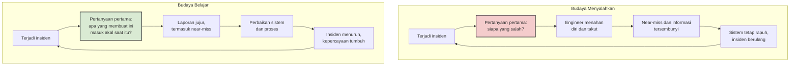

*Kredit foto: NASA — Wikimedia Commons, domain publik*

Tahun 1996, *The Journal of Applied Behavioral Science* menerbitkan sebuah paper dengan temuan yang pada mulanya tampak seperti kesalahan data. Amy Edmondson, saat itu baru menamatkan studi doktoralnya di Harvard, menghabiskan berbulan-bulan mengamati unit-unit keperawatan di sebuah rumah sakit untuk memetakan hubungan antara kualitas tim dan kesalahan pemberian obat yang tercatat. Asumsinya sederhana dan masuk akal: tim dengan kepemimpinan terbaik dan kohesi tertinggi seharusnya paling sedikit melakukan kesalahan. Data berkata sebaliknya. Justru tim-tim terbaik — paling terorganisasi, paling saling mendukung — yang mencatat angka kesalahan tertinggi.

Untuk beberapa waktu, pola ini terlihat seperti anomali statistik. Penafsiran yang akhirnya muncul jauh lebih menarik: kesalahan kemungkinan besar terjadi dengan frekuensi yang kurang lebih sama di semua tim. Yang berbeda adalah pelaporannya. Pada tim yang sehat, perawat berani mengakui dan mendokumentasikan kesalahannya; pada tim lainnya, kesalahan yang sama menguap tanpa jejak. Angka di kertas tidak mengukur frekuensi kegagalan, melainkan keberanian melaporkannya. Judul paper itu menangkap persoalannya dengan tepat: *Learning from Mistakes is Easier Said Than Done* — belajar dari kesalahan memang lebih mudah diucapkan daripada dilakukan.

Dari penelitian itu lahir konsep yang kelak menjadi salah satu yang paling berpengaruh dalam riset organisasi modern: *psychological safety*, keyakinan bahwa seseorang tidak akan dihukum atau dipermalukan karena berbicara — menyampaikan ide, bertanya, mengingatkan, atau mengakui kesalahan. Istilahnya sendiri jauh lebih tua. Carl Rogers memakainya pada 1950-an untuk menjelaskan kondisi yang menumbuhkan kreativitas. Edgar Schein dan Warren Bennis mendefinisikannya pada 1965 sebagai iklim yang "mendorong percobaan sementara dan menoleransi kegagalan tanpa pembalasan, penolakan, atau rasa bersalah". W. Edwards Deming menempatkannya sebagai poin kedelapan dari empat belas prinsip manajemennya: usir rasa takut, agar semua orang bisa bekerja efektif untuk perusahaan. Pabrik Toyota mewujudkannya secara harfiah lewat tali *andon* yang bisa ditarik pekerja lini produksi mana pun untuk menghentikan seluruh jalur ketika melihat masalah.

## Lima Kunci dari Google

Dua dekade kemudian, konsep ini mendapat validasi skala besar dari tempat yang tidak terduga. Google menjalankan *Project Aristotle*, inisiatif bertahun-tahun untuk menjawab pertanyaan yang selama ini diteori para eksekutif: apa sebenarnya yang membuat sebuah tim efektif? Perusahaan itu menghabiskan waktu lama menganalisis ratusan tim internal, menguji segala hipotesis — komposisi bakat, kepribadian anggota, frekuensi interaksi. Hasilnya, seperti dirangkum artikel Wikipedia tentang *team effectiveness*, mengejutkan banyak orang: faktor terpenting adalah *psychological safety*, jauh melampaui faktor-faktor lain seperti keandalan antar anggota, kejelasan struktur, makna pribadi, dan rasa berdampak.

Siapa yang ada di dalam tim ternyata kurang menentukan dibandingkan bagaimana anggota tim memperlakukan suara satu sama lain. Tim berisi para bintang individual yang saling menutup diri kalah dari tim biasa-biasa saja yang berani bertanya "saya tidak paham, bisa jelaskan lagi?" tanpa takut dianggap bodoh.

## Ketika Taruhannya Miliaran Dolar

Bagi kita yang bekerja di software engineering, semua ini bukan wacana akademik. Buku *Site Reliability Engineering* dari Google menyatakan dengan gamblang: pada sistem berskala besar dengan laju perubahan tinggi, insiden dan gangguan adalah keniscayaan. Pertanyaannya bukan apakah sistem akan gagal, melainkan apa yang kita lakukan setelahnya — karena tanpa proses formal untuk belajar, insiden yang sama akan berulang tanpa akhir.

Skala kegagalan di industri ini sudah mencapai tingkat yang sulit dibayangkan. Pada 19 Juli 2024, satu *update* konfigurasi yang cacat dari CrowdStrike menjatuhkan sekitar 8,5 juta komputer Windows di seluruh dunia — disebut sebagai outage terbesar dalam sejarah teknologi informasi, dengan kerugian finansial global ditaksir puluhan miliar dolar. Yang patut dicermati dari peristiwa itu: analisis pasca-insiden yang diterbitkan CrowdStrike sendiri tidak menemukan satu "penjahat" tunggal. Yang ditemukan adalah rangkaian kegagalan proses — celah validasi yang seharusnya menangkap masalah itu sebelum sampai ke produksi. Ketika kegagalan bersifat sistemik, menghukum individu tidak memperbaiki apa pun. Yang dilakukannya hanyalah memastikan laporan berikutnya datang terlambat, atau tidak datang sama sekali.

## Belajar dari Kebakaran di Landasan

Budaya bebas menyalahkan punya akar di industri-industri di mana kesalahan berarti kematian: penerbangan dan kesehatan. Contoh paling dramatisnya terjadi pada 27 Januari 1967, ketika kebakaran di kokpit Apollo 1 selama uji di darat menewaskan tiga astronaut NASA. Dalam pidato legendaris di hadapan timnya beberapa hari kemudian, flight director Gene Kranz tidak mencari kambing hitam. Ia justru mengaku: "Kami terlalu *gung-ho* mengejar jadwal sehingga menutup mata terhadap seluruh masalah yang kami lihat setiap hari." Dari situ lahir tuntutan yang dikenal sebagai dikum Kranz: setiap orang di mission control wajib *tough and competent* — keras dan kompeten. Program Apollo dibekukan, modul komando didesain ulang total, dan dua setengah tahun kemudian manusia berdiri di bulan dengan perangkat yang jauh lebih aman. Ketika pesawat ulang alik Columbia jatuh pada 2003, administrator NASA mengutip ulang pidato Kranz yang sama.

Perhatikan polanya. Kranz tidak menurunkan standar — ia menaikkannya. Yang ia hapus adalah mekanisme bertahan diri yang membuat masalah tak pernah sampai ke permukaan. Inilah pasangan yang sering disalahpahami: bebas menyalahkan bukan berarti lunak, melainkan menggeser akuntabilitas dari individu ke sistem. Dalam bukunya *Failure Is Not an Option*, Kranz menunjukkan bahwa kedua hal itu berjalan bersama: tuntutan sempurna pada proses, bukan pengadilan pada orang.

## Blameless Postmortem dalam Praktik

Di dunia rekayasa perangkat lunak, instrumen utama budaya belajar ini adalah *blameless postmortem* — dokumen tertulis yang merekam dampak insiden, tindakan mitigasi, akar penyebab, dan tindak lanjut pencegahan. Bab 15 buku SRE Google merinci filosofinya: menulis postmortem bukanlah hukuman, melainkan kesempatan belajar bagi seluruh perusahaan. Syaratnya tegas — fokus pada penyebab kontributor tanpa menuduh individu atau tim mana pun, dengan satu asumsi dasar: semua orang yang terlibat berniat baik dan melakukan hal yang benar dengan informasi yang mereka miliki saat itu. Kalimat kuncinya layak dihafal setiap pemimpin tim: Anda tidak bisa "memperbaiki" manusia, tetapi Anda bisa memperbaiki sistem dan proses agar manusia lebih mudah mengambil keputusan yang benar.

Beberapa praktik yang membedakan postmortem yang hidup dari sekadar ritual:

**Kriteria dipicu sebelum insiden terjadi.** Tim perlu sepakat lebih dulu kapan postmortem wajib ditulis — downtime yang terlihat pengguna, kehilangan data, intervensi on-call, waktu resolusi di atas ambang tertentu — sehingga keputusannya objektif, bukan mood-dependent.

**Kronologi dulu, interpretasi kemudian.** Rapat dimulai dari membangun timeline fakta: jam berapa alert menyala, siapa mengerjakan apa, keputusan mana yang diambil kapan. Hanya setelah kronologi utuh barulah akar penyebab digali. Urutan ini mencegah lompatan ke kesimpulan yang nyaman.

**Ganti pertanyaannya.** Alih-alih "kenapa dia menghapus database produksi", tanyakan "apa yang membuat tindakan itu tampak benar pada saat itu". Pertanyaan pertama menuntut pembelaan; yang kedua menghasilkan pemahaman — biasanya berupa konteks yang hilang, guardrail yang tidak ada, atau tekanan jadwal yang melahirkan jalan pintas masuk akal.

**Action item punya pemilik dan tenggat.** Postmortem tanpa tindak lanjut hanyalah dokumen pemakaman insiden. Setiap perbaikan perlu nama penanggung jawab dan tanggal — lalu benar-benar ditagih.

**Jangan mengstigma tim yang banyak menulis postmortem.** Buku SRE Google secara eksplisit memperingatkan ini: tim yang paling sering menulis postmortem sering kali justru tim yang paling jujur dan paling cepat belajar, bukan yang paling buruk. Menghukum produktivitas postmortem adalah cara paling pasti membunuh pelaporan.

**Pemimpin berbicara paling akhir, dan berterima kasih lebih dulu.** Dalam rapat review, pemimpin yang menyimpulkan lebih awal secara tidak sadar memberi tahu tim bahwa diskusi hanya formalitas. Menahan pendapat sampai semua perspektif teknis terdengar memberi ruang bagi fakta yang tidak nyaman untuk muncul. Dan orang yang pertama kali melaporkan insiden — sering kali dengan gemetar — layak didahului dengan terima kasih, bukan interogasi.

Peran pemimpin di semua titik ini menentukan. Pertanyaan pertama yang keluar dari mulut manajer setelah insiden adalah pelajaran yang paling berkesan bagi tim — jauh lebih berkesan daripada slide training apa pun. Jika pertanyaan itu "siapa yang deploy?", laporan berikutnya akan datang dalam bentuk yang sudah dirapikan. Jika pertanyaannya "bagaimana kondisimu, dan apa yang bisa kita perbaiki bersama", laporan akan datang lebih cepat dari yang kita sangka. Sebagai orang yang memimpin review insiden, saya berulang kali harus menahan refleks pertama saya sendiri — keinginan cepat tahu siapa yang menyentuh apa — dan mengarahkannya ke pertanyaan tentang sistem. Tidak selalu berhasil, tapi arah latihannya jelas.

## Bukan Berarti Tanpa Konsekuensi

Keraguan yang paling sering muncul dari para engineering manager: kalau tidak ada yang disalahkan, bukankah ini undangan bagi orang yang ceroboh? Pemahaman ini keliru membingkai pilihan sebagai biner antara menyalahkan atau membiarkan. Budaya yang sehat memisahkan dua jalur. Kesalahan yang terjadi dalam batas niat baik dan proses yang wajar masuk jalur belajar: dianalisis, didokumentasikan, ditindaklanjuti. Kelalaian berat atau pelanggaran kesengajaan masuk jalur manajemen kinerja — dibicarakan terpisah, tidak pernah di forum postmortem. Mencampur keduanya adalah cara tercepat membuat forum pertama kehilangan fungsinya, karena semua orang akan memperlakukan setiap review sebagai sidang terselubung.

Dalam buku *Right Kind of Wrong* yang memenangkan penghargaan Financial Times Business Book of the Year 2023, Edmondson menyebut pembedaan ini sebagai inti dari gagal dengan baik: kegagalan yang berasal dari eksperimen di wilayah tidak pasti adalah bahan bakar pembelajaran, sementara kegagalan karena mengabaikan proses yang sudah disepakati adalah masalah disiplin. Pemimpin yang baik tahu membedakan keduanya — dan tahu bahwa mayoritas insiden di sistem kompleks berada di kategori pertama.

## Menutup Lingkaran

Kembali ke paradoks di awal. Jika dashboard tim Anda menunjukkan nol insiden selama berbulan-bulan, ada dua kemungkinan: sistem Anda memang luar biasa, atau laporan Anda yang tidak jujur. Yang kedua jauh lebih mungkin. Tim terbaik tampak lebih buruk di atas kertas karena angkanya jujur — near-miss dicatat, kesalahan kecil diakui, postmortem ditulis tanpa diminta. Tugas pemimpin bukan mencegah setiap kegagalan, yang itu mustahil, melainkan merancang apa yang terjadi setelah kegagalan itu datang: apakah ia menjadi bahan bakar perbaikan, atau menjadi rahasia yang dikubur sampai meledak dalam skala yang jauh lebih besar.

Ruang mission control pada foto di atas ini mengelola krisis Apollo 13 — misi yang kemudian disebut "kegagalan sukses" karena justru menjadi bukti terbaik apa yang bisa dilakukan tim yang berani berbicara jujur di bawah tekanan. Semua orang di ruangan itu tahu satu hal: masalah yang diangkat ke meja adalah masalah yang bisa diselesaikan. Masalah yang disembunyikan adalah yang membunuh.

## Referensi

1. Edmondson, A. C. (1996). "Learning from Mistakes is Easier Said Than Done: Group and Organizational Influences on the Detection and Correction of Human Error." *The Journal of Applied Behavioral Science*, 32(1), 5–28. DOI: 10.1177/0021886396321001
2. Edmondson, A. C. (1999). "Psychological Safety and Learning Behavior in Work Teams." *Administrative Science Quarterly*, 44(4), 350–383.
3. Edmondson, A. (2018). *The Fearless Organization: Creating Psychological Safety in the Workplace for Learning, Innovation, and Growth*. Wiley.
4. Edmondson, A. (2023). *Right Kind of Wrong: The Science of Failing Well*. Atria Books.
5. Lunney, J. & Lueder, S. "Postmortem Culture: Learning from Failure." *Site Reliability Engineering* (Google SRE Book), Bab 15. https://sre.google/sre-book/postmortem-culture/
6. Kranz, E. (2000). *Failure Is Not an Option: Mission Control from Mercury to Apollo 13 and Beyond*. Berkley Books.
7. Wikipedia: "Team effectiveness" (bagian Project Aristotle). https://en.wikipedia.org/wiki/Team_effectiveness
8. Wikipedia: "2024 CrowdStrike-related IT outages". https://en.wikipedia.org/wiki/2024_CrowdStrike-related_IT_outages
9. Wikipedia: "Psychological safety" (sejarah konsep: Rogers, Schein & Bennis, Deming, Toyota). https://en.wikipedia.org/wiki/Psychological_safety
