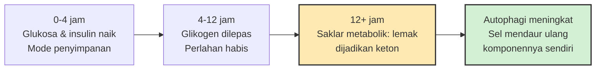

*Kredit foto: Muhamad Izzul Fiqih, Wikimedia Commons, CC BY-SA 4.0*

Beberapa tahun terakhir, puasa menjadi barang tren kesehatan. Aplikasi pelacak jendela makan bermunculan, selebriti fitness membagikan rutinitas 16:8, dan istilah *intermittent fasting* berubah dari jargon laboratorium menjadi percakapan kafe. Bagi umat Islam, ironi ini cukup menghibur: jadwal lapar yang sedang dijual mahal sebagai *biohack* itu sudah kita jalankan sekitar empat belas abad — puasa Ramadan sebulan penuh, ditambah puasa sunnah Senin-Kamis yang pernah menjadi kebiasaan Nabi ﷺ.

Pertanyaan yang lebih menarik bukan siapa yang lebih dulu, melainkan: ketika sains benar-benar menguji lapar terjadwal ini dengan standar ketat, apa yang ditemukannya? Jawabannya tersusun dari tiga lapis temuan — satu Nobel Prize, satu uji klinis besar yang mendinginkan hype, dan satu meta-analisis tentang Ramadan sendiri. Ketiganya, jika dibaca utuh, justru mengembalikan kita ke tujuan awal puasa yang bukan ada di timbangan.

## Diet yang tidak pernah menyebut dirinya diet

Al-Qur'an menetapkan tujuan puasa dengan satu kata di akhir ayat: *"...diwajibkan atas kamu berpuasa sebagaimana diwajibkan atas orang-orang sebelum kamu agar kamu bertakwa"* (QS Al-Baqarah 2:183, terjemahan Kemenag). Bukan agar langsing, bukan agar tajam fokus, bukan agar umur panjang. Taqwa. Ayat berikutnya menutup dengan kalimat yang hampir playful: *"Dan berpuasa itu lebih baik bagimu jika kamu mengetahui"* (QS 2:184) — seperti seseorang yang tahu ada bonus di dalamnya tapi membiarkannya ditemukan belakangan.

Rasulullah ﷺ menggarisbawahi kekhasan ini dalam hadits qudsi: *"Semua amal anak Adam untuknya, kecuali puasa. Puasa itu untuk-Ku, dan Akulah yang akan membalasnya"* (HR Bukhari no. 1904). Dalam satu riwayat yang sama disebutkan bahwa puasa adalah perisai. Semua amal lain bisa dilihat orang — sedekah, shalat, tilawah. Puasa adalah satu-satunya ibadah yang nyaris tak terlihat dari luar; tidak ada yang tahu kita sedang menahannya kecuali Allah dan perut kita sendiri.

Kerangka ini penting sebelum masuk ke sains, karena cara kita membaca data akan berbeda. Kalau puasa adalah diet, maka ukurannya adalah kilogram dan kadar gula. Kalau puasa adalah ibadah, maka data kesehatan hanyalah kabar tentang efek sampingnya — dan efek sampingnya, ternyata, cukup serius untuk dipelajari.

## Sel yang memakan dirinya sendiri

Lapisan temuan pertama datang dari biologi sel. Tahun 2016, Yoshinori Ohsumi menerima Nobel Kedokteran atas penemuan mekanisme *autophagy* — dari bahasa Yunani *auto* (diri) dan *phagein* (makan): "memakan diri sendiri". Ohsumi, lewat serangkaian eksperimen pada ragi roti awal 1990-an, berhasil mengidentifikasi gen-gen yang mengendalikan proses sel mengemas komponen rusaknya ke dalam membran, mengirimkannya ke *lysosome* (stasiun daur ulang sel yang ditemukan Christian de Duve, Nobel 1974), lalu memecahnya menjadi bahan bangunan yang bisa dipakai ulang.

Apa hubungannya dengan puasa? Komite Nobel menyebutnya secara eksplisit: autophagi berperan penting dalam **adaptasi terhadap kelaparan**. Ketika asupan nutrien berhenti, sel tidak panik — ia beralih ke mode hemat, membongkar komponen yang rusak atau berlebih, dan merealokasi bahannya untuk proses paling penting. Dalam tinjauan yang diterbitkan jurnal *Obesity*, Anton dan koleganya (2018) menjelaskan konsep *metabolic switch*: setelah berjam-jam tanpa asupan, tubuh berpindah bahan bakar dari glukosa menjadi keton yang diproduksi dari lemak, dan pada fase inilah berbagai respons adaptatif — termasuk peningkatan autophagi — mulai terdengar.

Yang jarang diceritakan dari kisah Nobel ini adalah betapa sederhananya titik startnya. Ohsumi tidak bekerja dengan manusia atau tikus, melainkan dengan sel ragi roti — organisme sejuta umat yang dipakai membuat roti dan bir. Kesulitannya: autophagi hampir mustahil diamati pada kondisi normal, jadi Ohsumi merancang trik cerdas. Ia melucuti gen-gen pengurai sel ragi sekaligus, lalu membiarkan sel-sel itu kelaparan. Saat sel-sel rapuh itu dipaksa berpuasa, vesikela kecil berisi komponen yang hendak didaur ulang menumpuk di dalamnya hingga terlihat di bawah mikroskop. Dari situ ia memetakan belasan gen yang menggerakkan mesin pembersih tersebut — gen yang kemudian terbukti nyaris identik pada sel manusia. Dari adonan roti, kita belajar cara sel kita sendiri bertahan menghadapi kosong.

Satu catatan jujur perlu disampaikan di sini: autophagi itu berjalan terus-menerus di level dasar, puasa hanya *meningkatkannya*; dan bukti terkuat tentang manfaat peningkatan ini masih berasal dari studi sel dan hewan, bukan dari mengukur organ orang yang rajin Senin-Kamis. Membaca Nobel 2016 sebagai "puasa 16 jam = servis besar sel" adalah lompatan yang lebih besar daripada yang diizinkan datanya.

## Uji klinis yang mendinginkan hype

Lapisan kedua justru bergerak berlawanan arah dengan hype. Tahun 2022, tim dari Southern Medical University Guangzhou menerbitkan uji klinis acak di *New England Journal of Medicine* — dari tim yang justru selama ini banyak memublikasikan manfaat pembatasan waktu makan. Mereka membagi 139 orang dewasa dengan obesitas menjadi dua kelompok selama 12 bulan: kelompok pertama membatasi kalori *dan* makan hanya dalam jendela 8 jam setiap hari (kurang lebih pola yang dijual aplikasi kebugaran); kelompok kedua membatasi kalori saja, bebas jam makan.

Hasilnya: kelompok jendela waktu turun 8,0 kg; kelompok kalori saja turun 6,3 kg. Selisih bersih 1,8 kg — dan secara statistik **tidak signifikan** (P = 0,11). Ukuran lingkar pinggang, lemak tubuh, tekanan darah, dan faktor risiko metabolik lainnya juga tidak berbeda bermakna. Kesimpulan Liu dan koleganya (2022) kering tapi penting: jendela waktu bukan tombol ajaib. Yang menentukan hasil tetap berapa dan apa yang masuk ke mulut kita — jam berapa kita memakannya adalah urusan kedua.

Artinya, orang yang berpuasa 16 jam lalu berbuka dengan gorengan berkalori penuh hasrat tidak sedang "mengaktifkan autophagi" — ia sedang menunda makan. Temuan ini selaras dengan sikap lembaga kesehatan yang lebih hati-hati: artikel Wikipedia tentang puasa intermiten mencatat bahwa National Institute on Aging menilai bukti belum cukup untuk merekomendasikannya sebagai intervensi kesehatan umum, dan pola ini tidak dianjurkan bagi ibu hamil, ibu menyusui, anak-anak, maupun orang berisiko hipoglikemia.

## Data dari sebulan puasa sendiri

Lapisan ketiga paling relevan untuk kita: apa yang terjadi pada ribuan orang yang benar-benar berpuasa Ramadan? Jahrami dan koleganya (2020) merangkum 85 studi dari 25 negara, melibatkan 4.176 orang, dalam meta-analisis yang terbit di *European Journal of Nutrition*. Temuannya: puasa Ramadan menurunkan berat badan secara signifikan — tapi kecil, rata-rata sekitar satu kilogram. Moderator yang paling berpengaruh bukan usia atau jenis kelamin, melainkan durasi puasa per hari. Meta-analisis lain oleh Kul dan koleganya (2014) terhadap 30 studi menemukan penurunan LDL dan gula darah puasa setelah Ramadan, sementara perubahan berat badan pada subkelompok perempuan bahkan tidak signifikan.

Gambar yang muncul konsisten: satu bulan berpuasa *bukan* program pelangsing. Tinjauan sistematis di jurnal *Nutrients* oleh Tsitsou dkk. (2022) yang membandingkan pembatasan waktu makan dengan puasa Ramadan menyimpulkan hal serupa dengan sentuhan menarik — puasa 14 jam bisa sama efektifnya dengan 16 jam, dan penurunan berat yang berarti (>5%) baru terjadi ketika puasa *diiringi* pembatasan kalori. Durasi bukan kompetisi; isi piring yang menentukan.

Detail lain dari meta-analisis Jahrami layak digarisbawahi karena dekat dengan keseharian kita: faktor yang paling memengaruhi hasil bukan usia atau jenis kelamin, melainkan **durasi puasa per hari**. Ini penjelasan yang masuk akal untuk hasil-hasil yang tampak bertabrakan antarnegara. Orang yang berpuasa Ramadan di Indonesia menahan diri sekitar 13 jam — nyaris persis jendela yang dipelajari laboratorium pembatasan waktu makan. Sementara itu, Muslim di Eropa utara saat musim panas bisa berpuasa 18–19 jam; kategorinya sama, dosis "lapar terjadwal"-nya berbeda drastis. Sains memperlakukan keduanya sebagai paparan yang tidak sama — dan mungkin kita sebaiknya juga, misalnya menahan diri dari membandingkan level kesulitan spiritual antarzona waktu.

Bacaan ini menyegarkan. Selama ini kita sering dihantam dua narasi ekstrem: ustadz gym yang menjanjikan Ramadan sebagai bulan transformasi tubuh, dan skeptis yang menuduh puasa cuma merusak metabolisme. Datanya berkata sesuatu yang lebih tenang: tubuh manusia dirancang menangani lapar terjadwal dengan baik, manfaat metaboliknya nyata tapi moderat, dan semuanya bisa dikalahkan oleh satu porsi berbuka yang tidak menahan diri.

## Yang tidak terbaca di timbangan

Kalau hasil metaboliknya "moderat", kenapa tradisi ini bertahan empat belas abad dan terasa tetap hidup? Mungkin karena manfaat utamanya memang tidak pernah diukur dalam kilogram.

Hadits Bukhari tadi menyebut puasa sebagai perisai — dan latihan perisai selalu tentang latihan menunda. Puasa adalah satu-satunya momen rutin di mana dorongan yang sangat sah (lapar, haus, marah karena lapar) datang tepat waktu, dan kita memutuskan untuk tidak segera memenuhinya. Bukan karena dorongannya salah, tapi karena ada yang lebih tinggi di atasnya. Dalam istilah sederhana: puasa melatih jarak antara impuls dan tindakan — otot yang sama yang kita pakai untuk tidak membalas komentar pedas di rapat, atau tidak membuka ponsel di sepertiga malam.

Frekuensi yang dipilih Nabi ﷺ juga bicara: *"Nabi ﷺ berusaha berpuasa pada hari Senin dan Kamis"* (HR At-Tirmidhi no. 745; riwayat serupa di An-Nasa'i no. 2364). Bukan sekali setahun dengan porsi heroik, tapi dua hari seminggu, bertahun-tahun. Pola yang oleh peneliti kebiasaan mana pun akan dikenali sebagai *repetition beats intensity* — latihan kecil yang konsisten mengalahkan acara besar yang musiman. Sebagai orang yang pekerjaannya menempel di layar dan jajannya datang mengikuti notifikasi, saya menemukan bahwa lapar terjadwal adalah latihan kendali yang jujur: tidak ada yang melihat, tidak ada yang memberi skor, dan satu-satunya yang menjaga adalah niat.

Maka mungkin inilah pembagian kerja yang pantas: biarkan sains memetakan efek sampingnya — autophagi, keton, gula darah, satu kilogram yang datang pergi — karena itu wilayahnya. Tapi orientasinya, seperti yang ditulis di akhir ayat, tetap satu kata yang tidak bisa diukur laboratorium mana pun: taqwa. Puasa bukan diet yang kebetulan ibadah; ia ibadah yang tubuh kita untungkan. Dan kalau suatu hari sains menemukan bahwa jendela 12 jam lebih baik dari 14 jam — ya, kita sudah lebih dulu diberi tahu bahwa untuk setiap penyakit ada obatnya, dan untuk setiap temuan baru akan ada temuan lagi. Yang tidak berubah adalah kerangka waktunya, dan Yang menunggu di ujung niatnya.

## Kalau ingin mengambil bonusnya dengan jujur

Bagi yang menjalankan puasa sunnah dan sekalian ingin efek kesehatannya, temuan-temuan di atas bicara cukup jelas. Jendela waktunya sudah cukup — puasa subuh sampai magrib di Indonesia (~13 jam) masuk rentang yang menurut data Tsitsou dkk. setara dengan 16 jam; menambah jam tambahan bukan peningkatan, hanya pamer. Yang benar-benar mengubah hasil adalah pertemuan antara jendela waktu dan kesadaran isi piring — pelajaran terbesar dari uji Liu di NEJM. Berbuka dengan dua porsi "karena sudah menahan seharian" adalah cara paling efektif membatalkan seluruh bonus metabolik sejak hari pertama.

Selebihnya soal pola: dua hari seminggu yang dijaga sepanjang tahun, seperti ritme Senin-Kamis, memberi lebih banyak hari latihan daripada satu bulan penuh lalu berhenti sebelas bulan. Batasnya juga perlu jujur diakui — yang sedang hamil, menyusui, punya riwayat gangguan makan, atau minum obat dengan jadwal makan ketat sebaiknya berbicara dengan dokter dulu; peringatan ini bukan basa-basi legal, melainkan catatan lembaga kesehatan yang meninjau buktinya.

Yang menarik, seluruh implikasi ini tidak menambahkan apa pun yang tidak sudah diajarkan tradisi: makan sahur secukupnya, berbuka tidak berlebihan, konsisten dalam jumlah kecil, dan syariat sendiri membebaskan yang sakit dan bepergian. Sains datang kemudian, mengukur, lalu mengangguk.

---

Tulis ini bukan untuk memilih antara iman dan data — keduanya sedang bicara tentang hal yang berbeda, dan keduanya jujur pada bagiannya sendiri. Selamat menjalankan puasa sunnah di pekan ini, semoga Senin-nya tidak berakhir di gorengan.

## Referensi

1. Nobel Prize Outreach — *The Nobel Prize in Physiology or Medicine 2016: Yoshinori Ohsumi, press release* (penemuan mekanisme autophagy). https://www.nobelprize.org/prizes/medicine/2016/press-release/
2. Anton, S.D., Moehl, K., Donahoo, W.T., dkk. (2018). "Flipping the Metabolic Switch: Understanding and Applying the Health Benefits of Fasting." *Obesity* 26(2):254–268. doi:10.1002/oby.22065
3. Liu, D., Huang, Y., Huang, C., dkk. (2022). "Calorie Restriction with or without Time-Restricted Eating in Weight Loss." *New England Journal of Medicine* 386(16):1495–1504. doi:10.1056/NEJMoa2114833
4. Jahrami, H.A., Alsibai, J., Clark, C.C.T., & Faris, M.A.E. (2020). "A systematic review, meta-analysis, and meta-regression of the impact of diurnal intermittent fasting during Ramadan on body weight in healthy subjects aged 16 years and above." *European Journal of Nutrition* 59(6):2291–2316. doi:10.1007/s00394-020-02216-1
5. Kul, S., Savaş, E., Öztürk, Z.A., & Karadağ, G. (2014). "Does Ramadan fasting alter body weight and blood lipids and fasting blood glucose in a healthy population? A meta-analysis." *Journal of Religion and Health* 53(3):929–942. doi:10.1007/s10943-013-9687-0
6. Tsitsou, S., Zacharodimos, N., Poulia, K.A., dkk. (2022). "Effects of Time-Restricted Feeding and Ramadan Fasting on Body Weight, Body Composition, Glucose Responses, and Insulin Resistance: A Systematic Review of Randomized Controlled Trials." *Nutrients* 14(22):4778. doi:10.3390/nu14224778
7. Al-Qur'an dan terjemahannya (Kemenag RI), QS Al-Baqarah ayat 183–184 — teks via API alquran.cloud. https://api.alquran.cloud/v1/ayah/2:183/id.indonesian
8. Hadits Riwayat al-Bukhari no. 1904 dan at-Tirmidhi no. 745 (juga an-Nasa'i no. 2364) — teks via sunnah.com. https://sunnah.com/bukhari:1904
9. Wikipedia — "Puasa intermiten" (catatan sikap National Institute on Aging dan peringatan kelompok rentan). https://id.wikipedia.org/wiki/Puasa_intermiten
