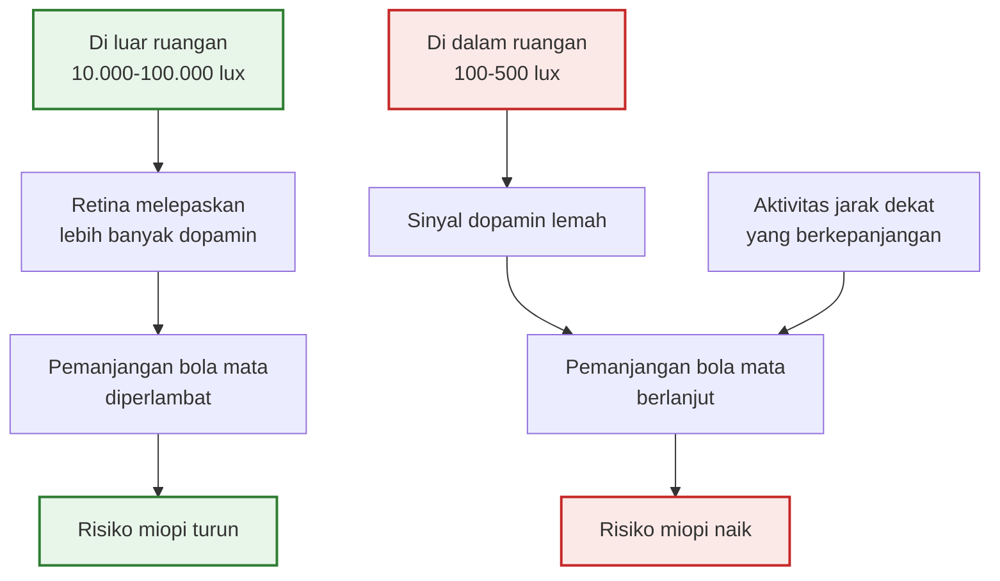

*Kredit foto: Wilfredor, Wikimedia Commons, CC0*

Pada tahun 2001, pemerintah Taiwan mulai melakukan sesuatu yang membosankan tapi jujur: setiap enam bulan, setiap sekolah dasar di negeri itu mengukur ketajaman penglihatan seluruh siswanya. Bukan sampel, bukan survei — sensus. Setiap tahun, data dari 1,2 hingga 1,9 juta anak masuk ke arsip Kementerian Pendidikan. Dan selama satu dekade, angkanya berkata hal yang sama: anak-anak semakin sulit melihat jauh. Prevalensi penglihatan merosot naik dari 34,8% pada 2001 menjadi 50,0% pada 2011. Setengah dari seluruh anak sekolah dasar.

Lalu garis yang selama ini hanya condong ke atas itu berbelok. Pada 2012 angkanya 49,4%; pada 2015 turun ke 46,1%. Analisis deret waktu yang memisahkan tren sebelum dan sesudah kebijakan menemukan perubahan yang sulit dianggap kebetulan: dari kenaikan rata-rata 1,58% per tahun menjadi penurunan 2,34% per tahun (Wu dkk., 2020).

Yang berubah bukan obat baru, bukan operasi, bukan kacamata ajaib. Sejak September 2010, melalui program bernama Tian-Tian 120 — kira-kira berarti "120 menit, setiap hari" — sekolah-sekolah di Taiwan didorong membawa anak keluar kelas selama dua jam sehari. Bermain di bawah langit. Itu saja.

Cerita Taiwan ini adalah salah satu babak paling meyakinkan dari sebuah epidemi yang jarang kita sebut dengan namanya: epidemi miopi.

## Bola Mata yang Tumbuh Terlalu Panjang

Miopi sering diperlakukan seperti keluhan ringan — sekadar "perlu kacamata". Secara fisik, yang terjadi sebenarnya lebih serius: bola mata tumbuh terlalu panjang dari depan ke belakang, sehingga cahaya yang masuk fokus di depan retina, bukan tepat di atasnya. Proses ini disebut pemanjangan aksial, dan sekali bola mata memanjang, ia tidak kembali pendek. Kacamata mengoreksi gejala; ia tidak menghentikan pertumbuhan.

Kenapa ini urusan besar? Karena miopi tinggi — di atas minus lima — bukan sekadar kacamata tebal. Bola mata yang memanjang meregang jaringan retina yang rapuh, dan risiko ablasio retina, glaukoma, serta degenerasi makula miopik ikut naik. Meta-analisis besar yang dirilis Brien Holden Vision Institute memproyeksikan bahwa pada 2050 sekitar 4,76 miliar orang — hampir separuh umat manusia — akan miopi, dan 938 juta di antaranya berada pada kategori miopi tinggi dengan segala risiko penglihatan permanen yang menyertainya (Holden dkk., 2016). Pada 2000, angkanya "hanya" 1,4 miliar, atau 22,9% populasi dunia.

Jendela waktunya juga penting dipahami. Miopi hampir selalu muncul pada usia sekolah dasar — sekitar enam hingga sepuluh tahun — dan terus memburuk sampai akhir remaja, karena itulah masa ketika bola mata masih tumbuh. Artinya, tahun-tahun ketika anak paling terkurung di ruang kelas dan ruang les adalah tahun-tahun ketika matanya paling sensitif terhadap lingkungan. Kesempatan melindunginya ada di tangan kita tepat ketika anak-anak masih menganggap bermain di luar adalah hak mereka, bukan tugas.

Asia adalah episentrumnya. Korea Selatan dilaporkan memiliki prevalensi miopi tertinggi di dunia, hingga 93% populasi; di Tiongkok, sekitar 80% anak sudah miopi ketika lulus SMA; di Taiwan, hingga 90% anak muda. Kota-kota Asia lain, termasuk di Asia Tenggara, menunjukkan arah tren yang sama.

## Tersangka yang Salah

Kalau genetika yang bertanggung jawab, kita punya masalah: genom manusia tidak berubah dalam tiga dekade. Orang tua miopi memang menurunkan risiko lebih tinggi kepada anaknya, tapi lonjakan secepat ini pasti digerakkan lingkungan. Pertanyaannya, lingkungan yang mana?

Tersangka utama masyarakat modern jelas: membaca terlalu dekat, lalu layar. Dugaan ini tidak sepenuhnya salah. Sebuah analisis Korea Selatan tahun 2025 terhadap 45 studi menemukan bahwa setiap tambahan satu jam waktu layar harian dikaitkan dengan peluang miopi sekitar 21% lebih tinggi. Tapi ketika peneliti mulai memilah variabelnya, muncul temuan yang mengejutkan: faktor yang paling konsisten dan paling kuat membedakan anak yang miopi dan yang bukan bukanlah seberapa banyak mereka menatap buku atau layar — melainkan seberapa sedikit mereka berada di luar ruangan.

Meta-analisis Sherwin dkk. (2012) di jurnal Ophthalmology merangkumnya: waktu di luar ruangan berhubungan dengan prevalensi miopi yang lebih rendah pada anak dan remaja, dan yang menarik, anak yang banyak bermain di luar ternyata dilindungi bahkan kalau mereka juga rajin membaca. Tinjauan besar Morgan dkk. (2018) di Progress in Retinal and Eye Research menaruh hubungan ini di pusat penjelasan epidemi miopi Asia Timur: pendidikan yang intensif membuat anak-anak menghabiskan hampir seluruh waktu terjaga mereka di dalam ruangan — ruang kelas, ruang les, ruang rumah.

## Generasi yang Pindah ke Dalam Ruangan

Untuk mendengar betapa radikalnya perubahan ini, bandingkan dua masa kanak-kanak. Kakek-nenek kita tumbuh di dunia yang sebagian besar pekerjaannya ada di luar rumah: berkebun, berdagang di pasar, berjalan kaki ke sekolah, bermain sampai maghrib di halaman dan kebun. Masa kanak anak zaman sekarang, terutama di kota besar Asia, hampir seluruhnya berlangsung di dalam kotak-kotak berpendingin ruangan: kelas dari pagi, les hingga sore, PR di meja belajar, hiburan di layar. Perpindahan itu terjadi hanya dalam dua generasi — terlalu cepat untuk evolusi biologi, cukup cepat untuk sebuah epidemi.

Taiwan, Korea Selatan, Hong Kong, dan Singapura memparodikan versi paling ekstremnya: hari sekolah yang panjang, bimbel malam, dan jam PR yang panjang — gabungan yang membuat paparan cahaya siang anak-anak tinggal beberapa puluh menit sehari. Para peneliti kadang menyebut epidemi miopi ini dengan julukan yang telak: epidemi pendidikan. Anak-anak tidak sakit karena gagal belajar; mereka berisiko karena terlalu sukses di dalam ruangan.

## Dopamin, Lux, dan Mata yang Dirancang untuk Padang Terbuka

Mekanismenya, sedetail apa pun perdebatan para ahli, bermuara pada sesuatu yang sederhana: cahaya. Bukan "melihat jauh" — mata yang rileks menatap kebun adalah bonus kecil — melainkan intensitas cahaya itu sendiri.

Ruang kelas yang terang menurut standar manusia hanya menyediakan beberapa ratus lux. Berdiri di bawah langit terbuka, mata menerima 10.000 hingga 100.000 lux atau lebih; hari mendung pun masih menyediakan ribuan lux, berkali-kali lipat ruangan paling terang. Retina merespons cahaya sebanyak itu dengan meningkatkan produksi dopamin, dan dopamin retina berfungsi sebagai rem kimia yang memperlambat pemanjangan aksial mata yang sedang tumbuh. Buktinya terkumpul dari studi pada hewan — di mana paparan cahaya terang terbukti menghambat miopi eksperimental — dan konsisten dengan pola epidemiologi manusia (Morgan dkk., 2018).

Cara pandang ini menggeser miopi dari masalah "kebiasaan" menjadi masalah nutrisi. Mata anak adalah organ yang tumbuh — dan seperti tulang yang butuh beban, ia tumbuh dengan benar hanya kalau mendapat "asupan" yang dirancangnya: hari-hari yang terang. Manusia berevolusi dengan mata yang matang di padang terbuka, bukan di ruang 300 lux.

## Bukti dari Uji Acak

Kalau Taiwan adalah bukti berskala negara, bukti terkerasnya datang dari uji acak terkontrol. Di Guangzhou, peneliti dari Zhongshan Ophthalmic Center mengacak 12 sekolah dasar menjadi dua kelompok: enam sekolah menambahkan satu sesi aktivitas luar ruangan 40 menit setiap hari dan mendorong orang tua melanjutkannya di akhir pekan; enam sekolah lain menjalankan rutinitas biasa. Setelah tiga tahun, insiden miopi pada kelompok intervensi 30,4%, bandingkan 39,5% pada kelompok kontrol. Empat puluh menit — selisih sembilan poin persentase (He dkk., 2015).

Studi lanjutan di Taiwan tahun 2025 mempersempit intervensinya sampai seminimal mungkin: sekadar mendorong anak keluar kelas saat jam istirahat. Pada anak yang sudah menunjukkan tanda pramiopi, kebiasaan rehat di luar ini menurunkan risiko onset miopi sebesar 61% dalam satu tahun.

Deretan bukti inilah yang membuat komunitas mata dunia sampai pada rekomendasi yang kini cukup baku: sekitar dua jam di luar ruangan setiap hari untuk anak-anak usia sekolah. Bukan jaminan, tapi pelindung terbaik yang kita kenal.

## Bukan Berarti Layar Menjadi Aman

Temuan ini kadang dibaca terbalik: "oh, berarti asal main di luar, layar bebas." Tidak begitu. Kerja jarak dekat tetap menjadi penopang epidemi — asosiasi 21% per jam layar itu nyata — dan anak yang dilepas dari layar tapi tetap menghabiskan hari di dalam rumah tetap kehilangan proteksi cahaya. Dua jam di luar adalah variabel terbesar yang bisa kita kendalikan, bukan alasan melonggarkan sisanya.

Satu batasan penting lagi: cahaya mencegah dan memperlambat onset miopi, tetapi tidak membalikkan miopi yang sudah terjadi. Kalau kacamata anak Anda bertambah tebal dari tahun ke tahun, itu wilayah kontrol miopi medis — atropin dosis rendah, lensa defokus, orthokeratologi — dan urusan dokter mata, bukan urusan sore di taman. Dan karena miopi sering mulai diam-diam di usia sekolah dasar, ada gunanya mengenali tanda-tandanya sejak dini: anak yang duduk makin dekat ke televisi, menyipitkan mata saat melihat jauh, atau keliru membaca tulisan di papan tulis. Pemeriksaan mata berkala untuk anak sebelum angka-angka itu mulai berjalan jauh lebih murah daripada mengejarnya belakangan.

## Dua Jam Itu Seperti Apa

Dua jam terdengar banyak sampai kita menyadarinya sebagai dosis harian, bukan acara. Jalan kaki ke sekolah, menunggu jemputan di halaman, bermain di teras setelah asar, ikut menjemur pakaian, bersepeda keliling kompleks sampai maghrib — semuanya menumpuk. Kuncinya menjadikan "keluar" sebagai kebiasaan latar, seperti sikat gigi.

Slot yang paling sering terbuang justru yang paling strategis: jam istirahat sekolah. Studi rehat Taiwan di atas menunjukkan sesuatu yang menenangkan — anak tidak butuh kelas olahraga tambahan atau kurikulum baru; mereka cukup didorong keluar kelas saat rehat, dan risiko onset miopi turun drastis. Untuk orang tua, ini berarti ada satu pertanyaan layak diajukan ke sekolah: ke mana anak-anak pergi saat jam istirahat? Pertanyaan sederhana itu kadang cukup untuk mengubah kebiasaan satu kelas, bahkan satu sekolah.

Tiga salah paham yang sering menggagalkannya: pertama, duduk dekat jendela bukan pengganti — kaca memangkas intensitas cahaya jauh di bawah langit terbuka. Kedua, menunggu hari cerah itu jebakan; hari mendung tetap menyediakan ribuan lux, selalu lebih terang dari ruang tamu. Ketiga, tidak perlu matahari langsung di mata — berteduh di bawah pohon pun tetap terhitung, karena yang dibaca retina adalah cahaya sekeliling, bukan sorotan.

Bukti paling jelas bahwa dosis cahaya harian ini sungguh bekerja datang dari pola musiman. Di negara empat musim, pemanjangan bola mata anak-anak tercatat jauh lebih cepat di musim dingin — ketika sihari pendek dan anak pulang sekolah saat langit sudah gelap — lalu melambat lagi di musim panas (Li dkk., 2026). Di Indonesia yang basah-kering, variasinya tidak se-ekstrem itu, tapi logikanya tetap sama: masa-masa ketika anak paling jarang keluar rumah adalah masa ketika matanya paling tak terlindungi. Musim hujan yang membuat semua orang berminggu-minggu di dalam ruangan adalah musim yang layak diwaspadai, bukan cuma karena banjir.

Sebagai ayah yang pekerjaannya menatap layar sepuluh jam sehari, saya membaca riset ini dengan campuran bersalah dan lega. Bersalah, karena telinga saya lebih cepat menangkap kata "jangan nonton terlalu dekat" daripada "ayo keluar dulu". Lega, karena hal yang melindungi mata anak-anak justru hal termurah yang mereka inginkan sejak awal: bermain di luar. Riset ini cuma memindahkannya dari kolom bonus ke kolom kebutuhan.

Ada pula temuan yang membuat investasi ini terasa lebih panjang: data kohort di Australia Barat menunjukkan waktu di luar ruangan pada masa kanak-kanak masih dikaitkan dengan risiko miopi yang lebih rendah saat dewasa (Lingham dkk., 2021). Cahaya yang diterima anak hari ini menyala sebagai perlindungan hingga dua puluh tahun kemudian.

Taiwan membuktikan bahwa lingkungan bisa diubah — bahkan untuk satu juta anak sekaligus. Keluarga adalah pembuat kebijakan terkecil, dan kebijakannya menulis dirinya sendiri: buka pintu, dorong anak keluar, dan biarkan langit bekerja. Dari semua intervensi kesehatan yang pernah diuji setelitinya ini, hanya ini satu-satunya yang dikenal anak-anak dengan nama lain: bermain.

## Referensi

1. Wu, P.-C., Chen, C.-T., Chang, L.-C., dkk. (2020). "Increased Time Outdoors Is Followed by Reversal of the Long-Term Trend to Reduced Visual Acuity in Taiwan Primary School Students." *Ophthalmology*, 127(11), 1462–1469. DOI: 10.1016/j.ophtha.2020.01.054
2. Holden, B. A., Fricke, T. R., Wilson, D. A., dkk. (2016). "Global Prevalence of Myopia and High Myopia and Temporal Trends from 2000 through 2050." *Ophthalmology*, 123(5), 1036–1042. DOI: 10.1016/j.ophtha.2016.01.006
3. He, M., Xiang, F., Zeng, Y., dkk. (2015). "Effect of Time Spent Outdoors at School on the Development of Myopia Among Children in China: A Randomized Clinical Trial." *JAMA*, 314(11), 1142–1148. DOI: 10.1001/jama.2015.10803
4. Sherwin, J. C., Reacher, M. H., Keogh, R. H., dkk. (2012). "The Association Between Time Spent Outdoors and Myopia in Children and Adolescents: A Systematic Review and Meta-analysis." *Ophthalmology*, 119(10), 2141–2151. DOI: 10.1016/j.ophtha.2012.04.020
5. Morgan, I. G., French, A. N., Ashby, R. S., dkk. (2018). "The Epidemics of Myopia: Aetiology and Prevention." *Progress in Retinal and Eye Research*, 62, 134–149. DOI: 10.1016/j.preteyeres.2017.09.004
6. Lingham, G., Yazar, S., Lucas, R. M., dkk. (2021). "Time Spent Outdoors in Childhood Is Associated with Reduced Risk of Myopia as an Adult." *Scientific Reports*, 11, 6337. DOI: 10.1038/s41598-021-85825-y
7. "Myopia." *Wikipedia* (bagian Epidemiology dan Environmental Factors) — data Korea Selatan 93%, Tiongkok 80%, analisis layar Korea 2025. https://en.wikipedia.org/wiki/Myopia
8. Wu, P.-C., dkk. (2025). "Outdoor Activity During Class Recess Prevents Myopia Onset and Shift in Premyopic Children." *Asia-Pacific Journal of Ophthalmology*, 14(1), 100140. DOI: 10.1016/j.apjo.2025.100140
9. Li, X., Zhao, C., Yin, M., dkk. (2026). "Comparison of Seasonal Variation in Myopia Progression." *Clinical Ophthalmology*, 20, 582774. DOI: 10.2147/OPTH.S582774
