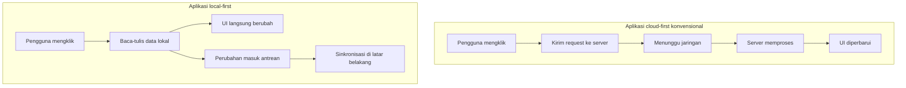

*Kredit foto: Dirk Murschall, Wikimedia Commons, CC BY 3.0*

Ada dua jenis aplikasi di dunia ini: yang terasa instan setiap kali kita klik, dan yang membuat kita menatap indikator loading sambil bertanya-tanya apakah klik tadi benar-benar terkirim. Yang menarik, perbedaan ini sering kali bukan soal seberapa cepat servernya — melainkan di mana datanya berada.

Coba perhatikan aplikasi yang oleh penggunanya dianggap paling responsif di kelasnya: Linear untuk manajemen pekerjaan, Figma untuk desain, Superhuman untuk email. Semuanya punya karakter yang sama: interaksi selesai dalam hitungan milidetik, tanpa jeda, tanpa spinner. Halaman dokumentasi Zero, sebuah sync engine open source buatan Rocicorp, menyebutnya secara terang-terangan — Linear, Figma, Superhuman, dan Dropbox dibangun dengan pola yang sama: data diunduh lebih dulu ke perangkat, proses baca-tulis terjadi secara lokal, dan perubahan disinkronkan ke server di latar belakang. Aplikasi-aplikasi itu terasa cepat bukan karena sihir, melainkan karena mereka tidak menunggu jaringan.

Pola ini punya nama resmi: **local-first software**. Dan di balik nama sederhananya tersimpan salah satu pergeseran arsitektur paling menarik dalam pengembangan aplikasi web satu dekade terakhir.

## Manifesto yang membalik arsitektur

Istilah local-first diperkenalkan lewat sebuah paper tahun 2019 dari Ink & Switch, lab riset independen yang didirikan salah satu pendiri Heroku. Paper itu ditulis Martin Kleppmann — dosen Ilmu Komputer di Cambridge yang juga penulis buku *Designing Data-Intensive Applications* — bersama Adam Wiggins, Peter van Hardenberg, dan Mark McGranaghan, dan dipresentasikan di konferensi Onward! ACM SIGPLAN. Paper ini sering disebut sebagai manifesto gerakan local-first.

Intinya satu kalimat: aplikasi seharusnya menyimpan data utamanya di perangkat pengguna, bukan di server. Server tetap ada, tapi perannya berubah — dari penguasa data menjadi alat sinkronisasi antar perangkat. Dalam arsitektur cloud konvensional, salinan yang berada di server adalah salinan resmi dan klien hanya tampilan tipis yang harus selalu meminta izin untuk membaca maupun menulis. Local-first membaliknya: salinan di perangkat adalah yang utama, dan sinkronisasi berjalan diam-diam ketika koneksi tersedia.

Manifesto itu mengusulkan tujuh ideal untuk aplikasi local-first: cepat (operasi selesai tanpa round-trip jaringan), multi-perangkat, bisa dipakai offline, mendukung kolaborasi, berumur panjang (data tetap tersedia meski vendornya tutup), menjaga privasi lewat enkripsi ujung-ke-ujung, dan memberi kendali penuh kepada pengguna atas datanya. Poin yang membuat paper ini tajam adalah pengakuannya: tidak ada satu pendekatan yang ada saat itu — dari lampiran email, sinkronisasi file ala Dropbox, sampai aplikasi web — yang mampu memenuhi ketujuhnya sekaligus.

Perlu dibedakan dari istilah yang lebih dulu populer: *offline-first*. Gerakan offline-first yang muncul awal 2010-an berfokus membuat aplikasi web tetap berfungsi saat jaringan terputus — semacam mode darurat. Local-first membangun di atasnya tapi menuntut lebih: kepemilikan data jangka panjang dan enkripsi ujung-ke-ujung menjadi warga kelas satu, bukan tambahan. Offline-first berkata "jangan mati saat koneksi hilang"; local-first berkata "perangkat pengguna adalah rumah utama datanya, titik."

## Seperti apa bedanya

Perbedaan kedua arsitektur ini paling mudah dilihat lewat alur satu kali klik:

Pada aplikasi cloud-first, setiap aksi pengguna adalah sebuah perjalanan pulang-pergi ke server: kirim request, tunggu latensi jaringan, tunggu server memproses, baru antarmuka diperbarui. Latensi jaringan yang 50–300 milidetik terasa kecil secara angka, tapi menumpuk menjadi pengalaman yang lambat. Pada aplikasi local-first, klik dieksekusi terhadap data yang sudah ada di memori perangkat — antarmuka berubah di frame berikutnya — sementara perubahan menyusul dikirim ke server tanpa pengguna menyadarinya.

Konsekuensi terbesarnya bukan hanya kecepatan, tapi ketahanan. Koneksi WiFi kafe tiba-tiba putus? Pesawat tanpa internet? Aplikasi tetap berfungsi penuh karena ia tidak sedang "meminjam" datanya dari server. Perubahan yang terjadi offline akan digabungkan nanti saat koneksi kembali.

## Masalahnya: dua orang mengedit hal yang sama

Kalau arsitekturnya sesederhana itu, semua orang pasti sudah melakukannya. Tantangan sesungguhnya muncul ketika perubahan offline harus digabungkan: bagaimana jika dua orang mengubah data yang sama di dua perangkat berbeda tanpa saling mengetahui?

Di sinilah mesin matematika local-first bekerja: **CRDT** (conflict-free replicated data type), tipe data terdistribusi yang secara formal didefinisikan pada 2011 oleh Marc Shapiro dan koleganya. Ide dasarnya: rancang struktur data sedemikian rupa sehingga setiap replika bisa diubah secara independen dan paralel, lalu digabungkan tanpa koordinasi, dengan jaminan semua replika pada akhirnya akan konvergen ke hasil yang sama. Wikipedia memberi contoh paling sederhana berupa flag boolean: sekali disetel `true` tidak bisa kembali ke `false`, dan aturan penggabungannya adalah "true menang". Merge seperti ini bersifat komutatif, asosiatif, dan idempoten — urutan dan pengulangan pengiriman tidak merusak hasil.

Tiga sifat itu bukan istilah akademis kosong; masing-masing menjawab kekacauan nyata jaringan. Komutatif berarti pesan yang tiba dalam urutan berbeda di dua perangkat tetap menghasilkan hasil sama. Asosiatif berarti penggabungan bertahap, sedikit demi sedikit, tidak mengubah akhir. Idempoten berarti pesan yang terkirim dua kali — sesuatu yang terjadi terus-menerus saat koneksi tidak stabil — tidak menduplikasi efeknya. Prinsip yang sama, pada tingkat kerumitan lebih tinggi, menjadi fondasi editor kolaboratif dan telah dipakai di sistem produksi seperti Redis, Riak, dan Azure Cosmos DB.

Pendekatan pendahulunya, operational transformation (OT) yang menopang Google Docs, bekerja dengan niat sama tapi jalur berbeda: mentransformasikan operasi agar bisa diterapkan dalam urutan berbeda. Figma, saat membangun fitur multiplayer-nya pada 2019, justru memilih menolak OT. Dalam tulisan tekniknya, Evan Wallace — co-founder Figma — menjelaskan bahwa mereka menganggap OT terlalu kompleks untuk kebutuhan mereka, mengutip peneliti Li dan Li yang menyebut bukti formal algoritma OT "rumit dan rentan kesalahan" bahkan hanya untuk dua operasi dasar penyisipan dan penghapusan. Figma akhirnya membangun sistem sendiri yang lebih dekat ke keluarga CRDT, dan hasilnya bisa kita rasakan setiap hari di editor desainnya.

## Ekosistem yang akhirnya matang

Paper 2019 bisa dibilang melampaui zamannya — idenya benar, tapi perangkatnya belum tersedia. Baru beberapa tahun terakhir ekosistemnya terasa lengkap, dan inilah alasan topik ini layak dipelajari sekarang.

Di lapisan penyimpanan, ada PGlite: build Postgres penuh dalam WebAssembly berukuran di bawah 3MB (terkompresi) yang bisa berjalan langsung di browser, lengkap dengan dukungan reaktivitas, sinkronisasi, bahkan ekstensi seperti pgvector. Konsep "database di browser" yang dulu terdengar seperti mainan kini benar-benar praktis.

Di lapisan sinkronisasi, bermunculan sync engine. ElectricSQL menyediakan Postgres Sync — mesin replikasi parsial yang mengirim data ke klien dalam bentuk "shapes", sehingga aplikasi hanya menarik irisan data yang benar-benar dibutuhkan pengguna, bukan seluruh database. Zero dari Rocicorp mengambil jalur serupa dengan ZQL, query engine streaming yang mereka klaim mampu memuat aplikasi issue tracker berisi 1,2 juta baris dalam waktu di bawah dua detik. Zero jujur soal tantangan yang mereka coba selesaikan: sinkronisasi itu mudah kalau datanya statis dan kecil, tapi menjadi sulit sekali ketika data besar dan perizinannya rumit — dan justru di situlah aplikasi nyata berada.

Di lapisan struktur data, library CRDT seperti Automerge (yang dikembangkan Kleppmann sendiri), Yjs, dan pendatang baru Loro menyediakan tipe kolaboratif siap pakai. Loro bahkan menyimpan histori versi lengkap "seperti Git" selama kolaborasi real-time berlangsung.

Yang menarik, gelombang ini kini bertemu dengan gelombang lain: ElectricSQL secara eksplisit memposisikan diri untuk "collaborative, multi-agent systems", dan Zero menyiapkan mode khusus untuk asisten AI seperti Claude dan Cursor. Ketika agen AI mulai membaca-menulis data aplikasi secara otonom dari mesin pengguna, kebutuhan akan sinkronisasi state yang andal justru meningkat — arsitektur local-first tiba-tiba relevan bukan hanya untuk aplikasi manusia.

Dunia luar ikut memperhatikan. Wired menulis feature tentang gerakan ini pada 2023, dan komunitasnya kini punya konferensi sendiri — Local-First Conf pertama digelar di Berlin pada Mei 2024, dengan edisi ketiga dijadwalkan di kota yang sama pada Juli 2026.

## Sisi yang jarang dibicarakan

Sebagai pendekatan rekayasa, local-first bukan obat untuk segalanya, dan kritik terhadapnya layak didengar sebelum kita ikut-ikutan antusias.

Masalah pertama adalah kompleksitas sinkronisasi itu sendiri. Perangkat yang offline berhari-hari, konflik yang menumpuk, dan penggabungan ribuan perubahan adalah persoalan yang tidak dihadapi arsitektur cloud konvensional. Kedua, CRDT menjamin konvergensi secara teknis, tapi hasil gabungannya belum tentu masuk akal secara semantik bagi pengguna — dua replika bisa sepakat pada sebuah kondisi yang aneh. Ketiga, migrasi skema menjadi mimpi buruk tersendiri: di server kita mengubah satu database, sedangkan di local-first kita harus berhadapan dengan ribuan perangkat yang menjalankan versi aplikasi berbeda-beda. Keempat, browser sendiri kadang menjadi musuh — Safari pernah dilaporkan menghapus data IndexedDB setelah tujuh hari tidak aktif, langsung menggoyang asumsi bahwa data lokal itu awet.

Ada juga perdebatan internal di komunitasnya: apakah local-first harus sepenuhnya terdesentralisasi, padahal banyak produk yang mengaku local-first tetap memakai server terpusat untuk autentikasi dan backup? Kleppmann sendiri, dalam bicaranya di Local-First Conf 2024, melunak: ketujuh ideal itu lebih tepat dipahami sebagai gradien yang didekati bertahap, bukan checklist yang harus lolos semua.

Bagi sebagian besar tim, posisi pragmatis inilah yang masuk akal. Aplikasi produktivitas, editor kolaboratif, catatan, task manager — semua kandidat alami local-first karena pola datanya banyak-tulis-sedikit-baca dan konfliknya bisa didamaikan. Sebaliknya, aplikasi yang hidup dari agregasi lintas pengguna — dashboard analitik real-time, marketplace, sistem pemeringkatan — tetap lebih sederhana dikerjakan dengan cloud-first konvensional. Memaksakan CRDT ke semua masalah hanya menambah kompleksitas tanpa manfaat.

## Menutup: latihan kecil untuk mulai

Saya tidak sedang menyarankan kita menulis ulang aplikasi produksi besok pagi. Tapi ada latihan kecil yang menurut saya layak dicoba setiap web developer sekali dalam kariernya: ambil satu fitur — satu form, satu tombol favorit, satu kolom status — dan ubah agar menulis ke penyimpanan lokal lebih dulu, dengan antrean yang mengirim ke server di belakang layar. Rasakan bedanya ketika UI tidak lagi menunggu round-trip jaringan. Dari latihan sekecil itu, pertanyaan-pertanyaan menarik akan mengalir sendiri: bagaimana kalau antrean gagal kirim, bagaimana kalau dua tab mengubah data yang sama, bagaimana kalau pengguna ganti perangkat di tengah jalan.

Pertanyaan-pertanyaan itulah yang sedang dijawab ekosistem local-first hari ini. Dan siapa pun yang pernah frustrasi menatap spinner mungkin setuju: arah jawabannya menyenangkan.

## Referensi

1. Wikipedia — *Local-first software*: definisi, tujuh ideal manifesto Ink & Switch, sejarah komunitas, dan kritik terhadap pendekatan ini. https://en.wikipedia.org/wiki/Local-first_software
2. Kleppmann, M., Wiggins, A., van Hardenberg, P., McGranaghan, M. (2019) — *Local-first software: You own your data, in spite of the cloud*, Ink & Switch / Onward! ACM SIGPLAN. https://www.inkandswitch.com/local-first/
3. Wikipedia — *Conflict-free replicated data type*: definisi formal (Shapiro dkk., 2011), sifat merge, dan contoh penggunaan produksi. https://en.wikipedia.org/wiki/Conflict-free_replicated_data_type
4. Wallace, E. (2019) — *How Figma's multiplayer technology works*, Figma Blog: alasan Figma menolak OT dan membangun sistem multiplayer sendiri. https://www.figma.com/blog/how-figmas-multiplayer-technology-works/
5. Rocicorp — *Zero: General-Purpose Sync for the Web*: arsitektur zero-cache/zero-client, ZQL, dan daftar aplikasi yang dibangun dengan pola sync. https://zero.rocicorp.dev/
6. ElectricSQL — dokumentasi Postgres Sync, shapes, dan primitif data untuk sistem multi-agent. https://electric-sql.com/
7. PGlite — *Embeddable Postgres*: build Postgres WASM di bawah 3MB dengan reaktivitas dan dukungan ekstensi. https://pglite.dev/
8. Loro — *Reimagine state management with CRDTs*: library CRDT performa tinggi dengan histori versi ala Git. https://loro.dev/
