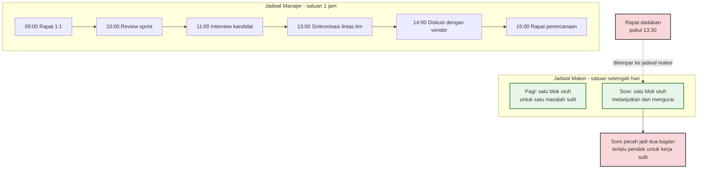
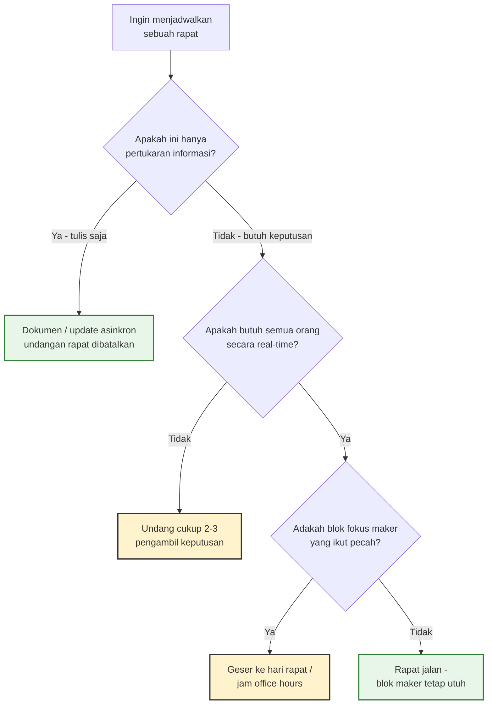

*Frances Benjamin Johnston, fotografer, di meja kerja studio-office-nya sekitar akhir 1800-an. Seorang maker dengan mejanya sendiri. (Kredit: Library of Congress, Wikimedia Commons, domain publik)*

Pada Juli 2009, Paul Graham—salah satu pendiri Y Combinator—menerbitkan esai pendek berjudul "Maker's Schedule, Manager's Schedule". Esai itu dibuka dengan pengakuan yang terasa familiar bagi siapa pun yang pernah memimpin tim engineering: programmer membenci rapat bukan karena antipati terhadap kolaborasi, melainkan karena perhitungan yang sederhana dan brutal. Bagi mereka, rapat jauh lebih mahal daripada yang tertera di kalender. Esai Graham bahkan mengutip Charles Dickens: "kesadaran semata akan sebuah janji temu kadang cukup untuk mencemahkan sehari penuh."

Hampir dua dekade kemudian, konflik yang dijelaskan Graham belum selesai—justru makin rumit sejak kerja hibrida dan chat kantor membuat batas antara "waktu rapat" dan "waktu kerja" kabur. Bagi engineering manager, ini bukan sekadar soal manajemen waktu pribadi. Ini soal bagaimana cara kita menjadwalkan rapat secara diam-diam menentukan berapa banyak pekerjaan sulit yang benar-benar selesai di tim kita.

## Dua frekuensi yang berbeda

Graham membagi cara manusia menggunakan waktu ke dalam dua jenis jadwal. Yang pertama adalah **jadwal manajer**: hari dipotong menjadi satuan satu jam, persis seperti buku janji temu klasik. Pindah kegiatan setiap jam adalah keadaan normal. Bagi pemilik jadwal ini, menambah satu rapat hanyalah masalah teknis—cari slot kosong, isi, selesai. Graham menyebutnya "jadwal perintah" (the schedule of command), karena kebanyakan orang berkuasa hidup di frekuensi ini.

Yang kedua adalah **jadwal maker**: milik orang-orang yang *membuat* sesuatu—programmer, penulis, desainer. Satuan waktunya minimal setengah hari. "Anda tidak bisa menulis atau memprogram dengan baik dalam satuan satu jam," tulis Graham. "Itu bahkan belum cukup untuk memulai." Ketika seorang maker punya satu rapat di sore hari, biayanya bukan durasi rapat itu. Satu rapat bisa membelah sore menjadi dua potongan yang masing-masing terlalu kecil untuk mengerjakan apa pun yang sulit. Dan ada efek berantainya: begitu tahu siang akan terpotong, kita jadi enggan memulai hal ambisius di pagi hari.

Graham memakai metafora yang setiap engineer pahami sempurna: bagi maker, rapat itu seperti *exception yang dilempar*. Ia tidak sekadar memindahkan kita dari satu task ke task lain—ia mengubah *mode* di mana kita bekerja.

Dan biayanya dimulai bahkan sebelum rapat berlangsung. Bagi pemilik jadwal manajer, rapat berikutnya hanyalah satu dari sekian slot kosong; tidak perlu dipikirkan. Tapi bagi maker, janji temu yang menunggu di jam tiga sore itu hadir di kepala sejak pagi—kita menghitung kapan harus berhenti, apa yang sempat dikerjakan sebelum berhenti, dan apa yang bisa dilanjutkan sesudahnya. Epigraf Dickens yang dipilih Graham bukan hiasan: kesadaran akan sebuah janji temu benar-benar bisa mencemahkan sehari penuh. Inilah alasan mengapa "rapat 30 menit" adalah unit yang menipu—ia mengklaim 30 menit, lalu menyewa pikiran kita jauh lebih lama dari itu.

Keduanya sah dengan sendirinya. "Setiap jenis jadwal berjalan baik jika berdiri sendiri," tulis Graham. "Masalah muncul ketika keduanya bertemu."

## Yang dikatakan sains tentang interupsi

Dugaan Graham ternyata punya dukungan empiris yang kuat dari bidang yang bahkan punya nama sendiri: *interruption science*, cabang psikologi human factors yang mempelajari bagaimana interupsi memengaruhi performa manusia. Definisi kerjanya yang umum dipakai—dari Boehm-Davis dan Remington—adalah "penangguhan satu aliran kerja sebelum selesai, dengan niat untuk kembali dan menyelesaikan aliran semula." Akar historisnya bahkan lebih tua dari ilmu komputer itu sendiri: pada 1920-an, Zeigarnik menunjukkan bahwa manusia mengingat tugas yang belum selesai lebih kuat daripada yang sudah tuntas—residu mental yang membuat pekerjaan yang terputus terus menghantui pikiran.

Angka-angka dari riset modernnya cukup mengejutkan. Gloria Mark, peneliti UC Irvine yang namanya melekat pada bidang ini, menemukan bahwa knowledge worker rata-rata berpindah task setiap tiga menit sekali—dan begitu terdistraksi, dibutuhkan hampir setengah jam untuk kembali ke task semula. Studi observasinya pada pekerja kantor menunjukkan setiap orang hanya bertahan sekitar 11 menit pada satu proyek sebelum akhirnya terinterupsi. Paper klasiknya di konferensi CHI 2008, "The cost of interrupted work: more speed and stress" (Mark, Gudith & Klocke, halaman 107–110), menemukan pola yang jahat: orang yang pekerjaannya terinterupsi cenderung bekerja lebih cepat untuk mengompensasi—tapi dengan tingkat stres yang lebih tinggi.

Untuk tim engineering secara khusus, literatur yang dirangkum dalam artikel *interruption science* mencatat temuan yang sangat relevan: satu tim programmer bisa terinterupsi lewat chat dukungan teknis hingga 150 kali sehari, dan angka ini berhasil diturunkan dengan dua intervensi sederhana—peran *dispatcher* yang menyaring permintaan, dan *knowledge base* yang menjawab pertanyaan berulang. Sementara itu, eksperimen terkontrol pada 63 knowledge worker oleh Zaman dkk. (2019) yang dipublikasikan di *Scientific Data* mengukur secara fisiologis bagaimana interupsi email yang terus-menerus versus yang dibatch memengaruhi stres dan produktivitas—membatch menang.

Intinya: satu rapat "cuma 30 menit" hampir tidak pernah benar-benar 30 menit. Biaya sebenarnya adalah waktu pemulihan sesudahnya, plus pekerjaan ambisius yang tidak pernah dimulai karena kita tahu sore akan pecah.

Riset tentang notifikasi melengkapi gambarannya. Perangkat lunak modern mengirim notifikasi tanpa memedulikan tugas yang sedang dikerjakan pemiliknya—dan literatur interruption science menemukan bahwa sekadar *tahu* bahwa sebuah notifikasi masuk sudah cukup untuk merusak atensi berkelanjutan, bahkan sebelum notifikasi itu dibuka. Ini menjelaskan mengapa budaya chat kantor yang menganggap semua pesan harus dijawab "sebentar saja" pada praktiknya adalah ribuan mikro-interupsi yang tidak pernah tercatat di kalender siapa pun. Beberapa solusi yang diteliti—misalnya *bounded deferral*, menunda pengiriman notifikasi sampai sistem mendeteksi jeda alami dalam pekerjaan—menunjukkan arah yang sama: interupsi paling murah adalah yang dijadwalkan oleh penerima, bukan oleh pengirim.

## Ini masalah kepemimpinan, bukan masalah produktivitas pribadi

Di sinilah esai Graham berubah dari tips manajemen waktu menjadi pelajaran kepemimpinan. "Karena kebanyakan orang berkuasa beroperasi di jadwal manajer," tulisnya, "mereka berada dalam posisi untuk membuat semua orang beresonansi pada frekuensi mereka—jika mereka mau." Kalimat ini, bagi saya, adalah salah satu deskripsi paling jujur tentang bagaimana budaya rapat sebuah organisasi terbentuk. Frekuensi pemimpin menular, bukan karena perintah, tapi karena kalender orang berkuasa adalah sumber daya langka yang semua orang berebut.

Team meeting mingguan satu jam sepertinya murah: satu jam dikali sepuluh orang, sepuluh jam. Tapi kalau dari sepuluh peserta itu enam orang sedang berada di tengah pekerjaan yang butuh fokus dalam—desain arsitektur, debugging yang dalam, tulisan spesifikasi—maka yang sebenarnya kita bayar adalah enam sore yang pecah. Engineering manager yang menjadwalkan rapat di tengah blok maker sedang membeli sesuatu yang harganya jauh di atas yang tertulis di undangannya.

Ada temuan menarik dari masa pandemi yang memperkuat bahwa frekuensi ini bisa dinegosiasikan. Riset besar yang diterbitkan di *Nature Human Behaviour*—menganalisis email, kalender, dan pesan instan 61.182 karyawan Microsoft selama enam bulan pertama 2020 (Yang dkk.)—menunjukkan bahwa kerja jarak jauh menyebabkan komunikasi sinkron menurun dan komunikasi asinkron meningkat. Organisasi *bisa* berpindah medium ketika dipaksa. Pertanyaannya cuma satu: apakah kita memperlakukan rapat sebagai pilihan termahal yang sengaja dipilih, atau default yang tidak pernah dipertanyakan?

Graham juga menyinggung jenis rapat yang paling sulit ditolak: *speculative meeting*, rapat spekulatif untuk sekadar saling kenal atau "melihat ada peluang kolaborasi." Di jadwal manajer, rapat seperti ini praktis gratis—slot kosong tinggal diisi, siapa yang rugi? Di dunia bisnis, rapat spekulatif bahkan punya bahasa khusus untuk mengajukannya. Tapi rapat yang gratis bagi pengundang bisa menjadi exception penuh bagi yang diundang. Kalau seorang engineering manager terbiasa memakai slot kosong kalendernya untuk rapat eksploratif dengan para engineer, ia sedang memindahkan biaya dari kalendernya sendiri ke kalender timnya—tanpa pernah melihatnya tercatat di mana pun.

## Lima praktik yang bisa langsung dijalankan

**Kluster rapat, jangan sebarkan.** Graham sendiri memakai perangkat klasik untuk ini: *office hours*. Beberapa kali seminggu ia menyetor satu blok waktu di akhir hari kerja untuk semua janji temu, sehingga rapat-rapat itu saling menempel. "Mereka memampatkan hari saya, tapi tidak pernah memutusnya." Praktik modern yang setara: menumpuk rapat di dua hari tertentu, menjadikan pagi sebagai zona bebas rapat, atau mengarahkan semua 1:1 ke satu jendela waktu.

**Hitung rapat dengan mata maker.** Sebelum mengundang orang, tanyakan: berapa banyak dari peserta yang sedang berada di tengah pekerjaan yang butuh fokus? Undang hanya decision maker yang benar-benar perlu hadir; sisanya bisa menerima hasil lewat dokumen. Mengurangi satu undangan adalah mengembalikan satu sore.

**Default-nya asinkron, rapatnya untuk keputusan.** Update status, sosialisasi informasi, dan review awal lebih efektif lewat tulisan—design doc, RFC, atau ringkasan mingguan. Kalau budaya tim Anda masih memakai rapat untuk menyebarkan informasi, itu tempat paling murah untuk memangkas jumlah rapat. Rapat sebaiknya disimpan untuk hal yang benar-benar membutuhkan dialog real-time: keputusan sulit, konflik, dan diskusi yang membutuhkan nuansa.

**Bangun jalur dispatcher.** Kalau engineer Anda terinterupsi chat dan DM sepanjang hari, salin solusi dari riset tersebut: satu kanal intake yang disaring (satu orang atau satu rotasi bertugas), plus knowledge base untuk pertanyaan berulang. Interupsi tidak bisa dihapus, tapi bisa dijadwalkan.

**Jujur memilih frekuensi Anda sendiri.** Ini bagian tersulit bagi engineering manager yang masih menyentuh kode. Graham menceritakan triknya di era startup 90-an: ia memprogram dari makan malam hingga jam tiga pagi, lalu mengurus "urusan bisnis" dari siang hingga makan malam—efektif menjalani dua hari kerja dalam sehari, satu di jadwal manajer dan satu di jadwal maker. Kita tidak harus mengikuti jadwalnya, tapi prinsipnya jelas: jangan berpura-pura bisa coding serius di sela-sela rapat. Lebih baik jaga satu blok maker yang benar-benar dihormati—satu pagi penuh tanpa undangan apa pun—daripada empat potongan satu jam yang tersebar di mana-mana.

Prinsip ini adalah inti dari yang Cal Newport sebut *deep work* dalam bukunya dengan judul yang sama: pekerjaan kognitif intensif yang menciptakan nilai justru membutuhkan konsentrasi yang sulit dicapai ketika kalender kita sudah dibelah-belah. Newport menyebut pekerjaan yang selamat dari kondisi itu sebagai "shallow work"—pekerjaan logistik yang bisa dikerjakan dalam keadaan terdistraksi. Tidak ada tim engineering yang dibangun dari shallow work semata; arsitektur, algoritma, dan debugging yang dalam semuanya adalah wilayah maker. Jadi ketika seorang pemimpin melindungi blok fokus timnya, ia bukan sedang memanjakan engineer—ia sedang melindungi satu-satunya jenis pekerjaan yang tidak bisa dibeli dengan menambah orang.

## Yang paling murah untuk diberikan

Ada banyak hal mahal yang bisa diberikan pemimpin kepada timnya: konferensi, tooling, bonus. Tapi salah satu yang paling murah—dan sering paling jarang diberikan—adalah sore yang tidak dipecah. Waktu yang tidak disentuh undangan rapat adalah bentuk paling konkret dari rasa hormat terhadap orang yang pekerjaannya membangun sesuatu.

Sebagai engineering manager yang juga masih suka menulis kode, saya paling sering gagal justru di sini: rapat yang saya sendiri jadwalkan dengan santai, lupa bahwa satu undangan berarti satu blok waktu yang pecah untuk orang lain. Kalender manajer memang enak dipakai—tinggal cari slot kosong. Justru karena itu, menahan diri sebelum menambah satu janji temu adalah keputusan kepemimpinan yang sesungguhnya.

Rapat berikutnya, mungkin ada baiknya kita bertanya dulu: apakah ini penting sampai rela melempar exception ke sore hari orang lain?

## Referensi

1. Graham, Paul. "Maker's Schedule, Manager's Schedule." Paulgraham.com, Juli 2009 — https://paulgraham.com/makersschedule.html
2. Mark, Gloria; Gudith, Daniela; Klocke, Ulrich. "The cost of interrupted work: more speed and stress." *CHI '08 Proceedings of the SIGCHI Conference on Human Factors in Computing Systems*, 2008, hlm. 107–110.
3. Wikipedia. "Interruption science" (mengutip temuan Gloria Mark tentang pergantian task tiap 3 menit, ~11 menit per proyek, dan studi tim programmer dengan 150 interupsi chat per hari) — https://en.wikipedia.org/wiki/Interruption_science
4. Yang, Longqi; Holtz, David; Jaffe, Sonia; dkk. "The effects of remote work on collaboration among information workers." *Nature Human Behaviour*, vol. 6, hlm. 43–54 (2021, diterbitkan daring 9 September 2021) — https://www.nature.com/articles/s41562-021-01196-4
5. Zaman, S.; Wesley, A.; Silva, D.R.D.C.; dkk. (termasuk Mark, G.). "Stress and productivity patterns of interrupted, synergistic, and antagonistic office activities." *Scientific Data* 6, 264 (2019). DOI: 10.1038/s41597-019-0249-5
6. Stangl, Fabian J.; Riedl, René. "Interruption science as a research field: Towards a taxonomy of interruptions as a foundation for the field." *Frontiers in Psychology*, vol. 14, art. 1043426 (2023) — https://www.frontiersin.org/articles/10.3389/fpsyg.2023.1043426/full
7. Newport, Cal. *Deep Work: Rules for Focused Success in a Distracted World*. Grand Central Publishing, 2016.
