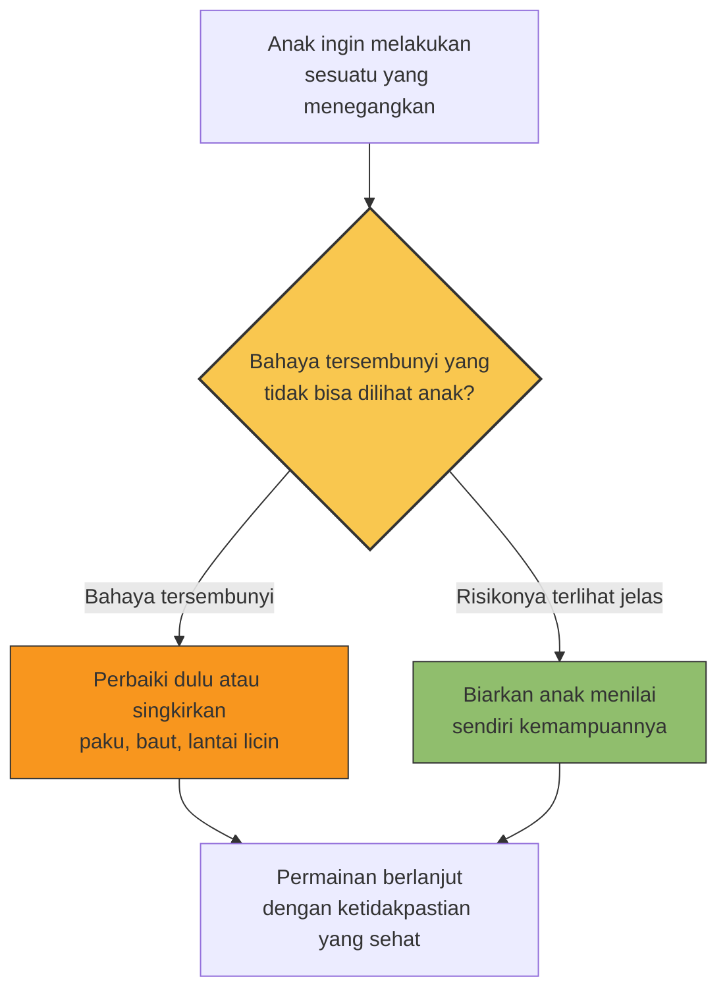
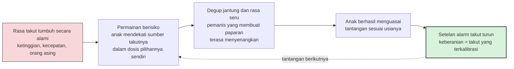

*Anak-anak memanjat beringin di sebuah taman. Bagi sebagian orang tua, pemandangan ini memicu refleks untuk mengulurkan tangan; bagi anak-anaknya, ini laboratorium kalibrasi. (Kredit: Wikimedia Commons, CC0)*

Tahun 1943, di tengah pendudukan Jerman atas Kopenhagen, sebuah taman bermain yang aneh berdiri di distrik Emdrup. Tidak ada perosotan yang sudah diuji laboratorium, tidak ada ayunan dengan permukaan anti-bentur. Yang ada: tumpukan kayu bekas, papan, paku, palu, dan tanah tempat anak-anak boleh membangun, membongkar, menyalakan api unggun, dan jatuh. Gagasan itu justru mendapat dukungan orang tua—salah satunya karena permainan anak-anak di jalanan saat itu bisa disangka sabotase oleh serdadu pendudukan, sehingga ruang bermain berpagar yang dikelola pengawas terasa lebih aman daripada tidak sama sekali.

Idenya lahir dari pengamatan yang jujur hingga nyaris memalukan. Carl Theodor Sørensen, arsitek lanskap Denmark yang merancang banyak taman bermain modern pada zamannya, menyadari bahwa anak-anak lebih tertarik pada tumpukan bahan bangunan dan rongsokan di sekitar karyanya daripada pada perosotan dan jungkat-jungkit yang ia desain dengan penuh perhitungan. Pada 1931 ia mengusulkan semacam "taman rongsokan tempat anak-anak bisa menciptakan dan membentuk, berangan-angan dan membayangkan kenyataan versi mereka sendiri." Emdrup menjadikannya nyata, dan konsep yang kemudian disebut *adventure playground* itu menyebar—dibawa ke Inggris lewat buku Marjory Allen tahun 1946 yang mengusulkan bekas lokasi bom perang diubah menjadi taman bermain serupa. Per 2015, sekitar seribu adventure playground beroperasi di Eropa, dan Jepang punya versinya sendiri seperti Hanegi Playpark di Setagaya, Tokyo.

Delapan dekade setelah Emdrup, kita bergerak ke arah yang berlawanan. Taman bermain masa kini dirancang agar tidak ada satu pun jahitan yang bisa mencubit jari. Dan sambil keselamatan fisik anak mencapai titik tertinggi dalam sejarah, kecemasan anak justru berada di titik yang memprihatinkan. Dua fakta ini berdiri berdampingan tidak kebetulan—sebuah cabang riset yang berkembang pesat sepuluh tahun terakhir berargumen bahwa keduanya berkaitan.

## Bermain yang membuat jantung berdetak

Istilah kerjanya *risky play*—permainan berisiko. Canadian Paediatric Society, dalam pernyataan posisi resminya tahun 2024, mendefinisikannya sebagai bentuk permainan bebas yang mendebarkan dan menegangkan, melibatkan ketidakpastian hasil, dan membawa kemungkinan cedera fisik. Perhatikan: definisinya menegaskan ketidakpastian, bukan bahaya. Yang membuat sebuah permainan "berisiko" adalah anak tidak tahu persis apa yang akan terjadi selanjutnya, dan dia sendiri yang harus menilai seberapa jauh kemampuannya.

Riset Ellen Beate Hansen Sandseter dari Queen Maud University College di Norwegia—yang dikutip luas dalam reviu-reviu berikutnya—memetakan permainan berisiko ke dalam enam kategori: bermain di ketinggian, bermain dengan kecepatan tinggi, alat berbahaya (pisau, palu, gergaji mainan sungguhan), elemen berbahaya (air dan api), gulat main kasar, dan permainan "menghilang"—berjalan menjauh hingga sempat merasa tersesat. Daftar itu terasa asing bagi orang tua modern, tetapi setiap kategori punya versi dewasanya yang kita akui sebagai kegiatan sehat: panjat tebing, bersepeda menuruni bukit, perkayuan, arung jeram, bela diri, dan mendaki sendirian.

## Risiko bukan bahaya

Kata "risiko" dalam permainan berisiko sering disalahpahami sebagai undangan ke ruang gawat darurat. Padahal literatur terbarunya justru menarik garis tegas antara dua hal yang sehari-hari kita campuradukkan: risiko dan bahaya (*hazard*). Risiko adalah ketidakpastian yang bisa dilihat dan dinilai oleh anak—cabang yang tinggi, dinding panjat yang licin setelah hujan. Bahaya adalah ancaman tersembunyi yang berada di luar kemampuan anak untuk menilai—paku yang menonjol, baut yang lepas, lantai yang ternyata licin tanpa terlihat.

Tugas orang tua, menurut kerangka yang dipakai Canadian Paediatric Society itu, bukan menghapus ketidakpastian, melainkan menyingkirkan bahaya lalu membiarkan risikonya tetap hidup:

Ini bukan sekadar trik semantik. Anak yang dijauhkan dari segala risiko tidak pernah berlatih menilai; anak yang dilatih menilai risiko kecil sedang membangun kompetensi yang kelak dipakainya saat orang tua tidak ada di sampingnya.

## Terapi anti-fobia tertua di dunia

Mengapa anak-anak—di semua budaya, di semua zaman—suka mencari ketinggian dan kecepatan? Paper Sandseter dan Leif Edward Ottesen Kennair di *Evolutionary Psychology* (2011) menawarkan penjelasan yang menurut saya salah satu yang paling elegan dalam psikologi perkembangan. Mereka berangkat dari teori non-asosiatif kecemasan: anak-anak secara alami mengembangkan rasa takut pada stimulus tertentu—ketinggian, orang asing, kegelapan—sebagai alarm bawaan yang melindungi mereka sebelum kemampuan mengatasi benar-benar berkembang. Alarm itu terpasang pabrik, tanpa perlu pengalaman traumatik apa pun.

Masalahnya, alarm yang tidak pernah diuji akan terus menyala terlalu sensitif. Permainan berisiko, dalam kerangka ini, adalah mekanisme kalibrasinya: anak mendekati sumber ketakutannya dalam dosis yang ia pilih sendiri, dibumbui emosi positif—degup jantung, tawa, rasa seru—yang membuat paparan itu terasa menyenangkan alih-alih traumatis. Setiap kali berhasil menguasai tantangan, setelan alarm turun satu tingkat. Sandseter dan Kennair menyebutnya efek anti-fobia: keberanian bukan ketiadaan rasa takut, melainkan rasa takut yang sudah terkalibrasi dengan kemampuan nyata. Mereka menutup paper itu dengan peringatan yang terdengar makin relevan: masyarakat yang menghalangi anak-anaknya dari permainan berisiko yang sesuai usia berisiko menuai lebih banyak neurotisisme dan psikopatologi.

## Apa kata bukti

Teori yang cantik tetap harus diuji. Reviu sistematis Brussoni dan kolega (2015) yang menganalisis 21 studi menemukan efek positif menyeluruh permainan berisiko di luar ruangan pada berbagai indikator kesehatan dan perilaku anak. Dan bulan lalu—Oktober 2026—PLoS ONE menerbitkan reviu sistematis campuran terbesar sejauh ini: Ramsden, Jerebine, Sandseter, Brussoni, Dodd, dan timnya menyaring 74 studi pada anak usia 3–12 tahun. Kesimpulannya berhati-hati tetapi konsisten arah: permainan berisiko umum dan lingkungan yang mendukungnya berasosiasi positif dengan kesehatan fisik, kesehatan mental dan kesejahteraan, kemampuan sosial, kognitif, dan kompetensi menilai risiko. Mobilitas independen—berjalan ke sekolah sendiri, misalnya—berasosiasi positif dengan aktivitas fisik.

Reviu itu juga jujur pada data yang tidak nyaman. Bukti untuk gulat main kasar tidak konsisten, dan malah ada asosiasi negatif dengan agresi—artinya sebagian studi menemukan lebih banyak gulat berkorelasi dengan meningkatnya agresi. Kualitas bukti keseluruhan dinilai rendah hingga moderat. Ini bukan mukjizat yang sudah terbukti sempurna; ini bidang riset muda yang semua indikatornya menunjuk arah sama. Sains yang baik justru begini: melaporkan nuansa, bukan hanya judul yang enak dibaca.

Yang mengejutkan adalah siapa yang sekarang ikut bersuara. Pernyataan posisi Canadian Paediatric Society 2024 itu mendorong dokter anak memandang permainan berisiko di luar ruangan sebagai salah satu cara mencegah dan mengelola masalah kesehatan yang paling umum menimpa anak masa kini: obesitas, kecemasan, dan masalah perilaku. Terminologinya khas: menjadikan anak "seaman perlunya" (*as safe as necessary*), bukan "seaman mungkinnya" (*as safe as possible*)—frasa yang dipinjam dari paper Brussoni tahun 2012.

## Teori loose parts

Ada pelajaran di sini yang menarik khususnya bagi kita yang bekerja membangun sistem. Arsitek Simon Nicholson, mengamati adventure playground, merumuskan apa yang kemudian disebut teori *loose parts*: derajat kreativitas dan kemampuan menemukan hal baru—serta kemungkinan penemuan—dalam lingkungan mana pun berkorelasi dengan jumlah dan variasi komponen lepas yang tersedia di dalamnya: ban bekas, papan, paku, palu, lumpur, benda temuannya sendiri. Dalam bahasa engineer: kreativitas berbanding lurus dengan jumlah variabel yang boleh dimanipulasi. Taman bermain standar adalah pustaka dengan dua fungsi; adventure playground adalah papan eksperimen penuh.

Peter Gray, profesor riset psikologi di Boston College dan penulis *Free to Learn* (2013), menegakkan argumen serupa dari sisi evolusi: bermain bebas dengan segala ketidakpastiannya adalah cara mamalia muda membangun kompetensi mengelola hidup, dan masa kanak-kanak yang terlalu diorganisasi dan diawasi memutus proses itu. Gray bahkan membantu mendirikan Let Grow, organisasi yang mendorong kemandirian anak melawan pola asuh helikopter. Di Eropa, wujudnya sudah lama melembaga: forest kindergarten—taman kanak-kanak tanpa atap dan dinding yang digagas Ella Flautau di Denmark awal 1950-an—menjadikan hutan sebagai ruang kelas dengan segala ketinggian, kecepatan, dan elemen berbahayanya.

## Latihan menilai, bukan ceramah

Praktiknya di rumah lebih sederhana daripada teorinya: audit bahayanya, lalu bela risikonya. Adventure playground punya profesi khusus untuk ini—*playworker*: dewasa yang hadir dan mengawasi, turun tangan hanya untuk bahaya sungguhan, dan selain itu menahan diri. Prinsip kerjanya bisa dipinjam ke rumah mana pun: intervensi minimum, ketersediaan maksimum. Beberapa bentuk konkretnya:

Ganti "hati-hati!" dengan pertanyaan. "Peganganmu yang mana? Rencana turunnya lewat mana?" Pertanyaan memaksa penilaian risiko menjadi eksplisit; teriakan hanya memaksa anak berhenti menilai dan menyerahkan penilaian pada kita.

Beri jeda sebelum menolong. Anak yang menggantung ragu di dinding panjat biasanya butuh tiga detik untuk berpikir, bukan tangan yang menyambar. Menolong yang terlalu cepat mengajarkan satu hal: kemampuannya tidak dipercaya.

Biarkan dia yang memutuskan naik atau turun. Anak yang memilih sendiri kapan berhenti sedang membaca instrumen internalnya—kewaspadaan, kekuatan, lelah. Instrumen itu hanya terkalibrasi jika dipakai.

Sediakan *loose parts* murah: kardus, tali, kayu, ember air. Lebih murah dari mainan mana pun dan, menurut Nicholson, jauh lebih produktif.

Dan untuk gulat main kasar: mainkan dengan aturan main yang disepakati sebelum mulai—dilarang memukul wajah, ada kata berhenti—karena reviu Ramsden menunjukkan asosiasinya dengan agresi membuat kategori ini paling perlu pagar.

## Menutup lingkaran

Sebagai ayah, saya mengenali betul refleks itu—tangan yang gugup ingin menopang setiap kali anak naik lebih tinggi dari yang nyaman bagi saya. Riset ini tidak menyuruh saya menghapus refleks itu, tapi menunjuk pekerjaan yang sesungguhnya: bukan menghapus risiko dari dunia anak, melainkan menyingkirkan bahaya yang tak bisa mereka lihat dan membiarkan mereka mengasah penilaian pada risiko yang bisa mereka lihat. Saya meminjam kalibrasi dari pekerjaan saya sehari-hari: sistem yang tidak pernah diberi gangguan tidak pernah belajar mengoreksi diri, dan alarm yang tidak pernah diuji tidak bisa dipercaya justru pada saat ia benar-benar dibutuhkan. Otak anak sedang membangun sistem semacam itu, dan bahan kalibrasinya adalah pohon yang boleh dipanjat, kecepatan yang boleh dicoba, dan jarak yang boleh ditempuh sendiri. Memar akan sembuh dalam hitungan hari; penilaian yang terkalibrasi dipakai seumur hidup.

## Referensi

1. Sandseter, E.B.H. & Kennair, L.E.O. (2011). "Children's risky play from an evolutionary perspective: the anti-phobic effects of thrilling experiences." *Evolutionary Psychology* 9(2): 257–284. DOI: 10.1177/147470491100900212. PMID: 22947972.
2. Brussoni, M., dkk. (2015). "What is the Relationship between Risky Outdoor Play and Health in Children? A Systematic Review." *International Journal of Environmental Research and Public Health* 12(6): 6423–6454. DOI: 10.3390/ijerph120606423.
3. Ramsden, R., Jerebine, A.G., Brailey, G., Sandseter, E.B.H., dkk. (2026). "Outdoor risky play and health-related outcomes in children aged 3–12 years: A mixed-methods systematic review." *PLoS ONE* 21(10): e0347444. DOI: 10.1371/journal.pone.0347444.
4. Beaulieu, E. & Beno, S. — Canadian Paediatric Society, Injury Prevention Committee (2024). "Healthy childhood development through outdoor risky play: Navigating the balance with injury prevention." *Paediatrics & Child Health* 29(4): 255–269. DOI: 10.1093/pch/pxae016.
5. Brussoni, M., Olsen, L.L., Pike, I. & Sleet, D.A. (2012). "Risky play and children's safety: balancing priorities for optimal child development." *International Journal of Environmental Research and Public Health* 9(9): 3134–3148. DOI: 10.3390/ijerph9093134.
6. Wikipedia: "Adventure playground" — sejarah Emdrup 1943, Carl Theodor Sørensen, Marjory Allen, dan teori loose parts Simon Nicholson. https://en.wikipedia.org/wiki/Adventure_playground
7. Wikipedia: "Peter Gray (psychologist)" — *Free to Learn* (2013), Let Grow, dan pandangannya tentang pola asuh helikopter. https://en.wikipedia.org/wiki/Peter_Gray_(psychologist)
8. Wikipedia: "Forest kindergarten" — sejarah Ella Flautau (Denmark, 1950-an) dan Skogsmulle (Swedia, 1957). https://en.wikipedia.org/wiki/Forest_kindergarten
