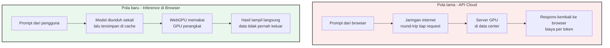

*Kredit foto: Jacek Halicki, Wikimedia Commons, CC BY-SA 4.0*

Selama lebih dari satu dekade, "aplikasi cerdas" hampir selalu berarti satu pola yang sama: aplikasi di browser mengirim data ke server, server mengerjakan AI-nya dengan GPU di data center, lalu hasilnya dikirim balik. Pola ini begitu melekat sampai kita lupa bertanya: kenapa harus begitu? GPU yang sanggup mengeksekusi model justru sudah ada di laptop dan ponsel yang kita pegang sekarang. Yang selama ini tidak ada bukanlah hardware-nya, melainkan izinnya — browser tidak punya cara untuk memakai GPU tersebut secara langsung.

Izin itu akhirnya datang. Sejak akhir 2025, semua browser utama mendukung WebGPU, standar baru yang membuka akses ke GPU dari JavaScript. Konsekuensinya mulai terasa pada 2026: model bahasa bisa diunduh sekali lalu berjalan sepenuhnya di dalam tab, tanpa satu byte pun data pengguna keluar dari perangkat. Sebagai web developer yang sudah belasan tahun melihat "platform web" terus menyerap kemampuan yang dulu hanya milik aplikasi native, saya menilai ini salah satu pergeseran arsitektur paling fundamental dalam beberapa tahun terakhir.

## Dari "WebGL Next" ke Mesin Komputasi Universal

WebGPU adalah API JavaScript yang distandardisasi W3C untuk mengakses GPU secara efisien lintas platform, berdiri di atas API natif Vulkan (Android/Linux), Metal (macOS/iOS), dan Direct3D 12 (Windows). Ia dirancang untuk menggantikan WebGL yang sudah berumur lebih dari satu dekade.

WebGL sebenarnya tetap sanggup menggambar grafis 3D yang indah, tapi ia lahir dari dunia OpenGL yang berorientasi menggambar, bukan menghitung. Tidak ada compute shader, tidak ada kontrol memori yang layak, dan koordinasi diserahkan ke driver — desain yang membuat ribuan core GPU sulit dipakai untuk hal lain selain me-render poligon. Kebutuhan komputasi umum itulah celah yang hendak diisi WebGPU sejak awal.

Perjalanan standarnya panjang. Wikipedia mencatat gagasan "WebGL Next" pertama dipresentasikan Google ke working group WebGL pada Juni 2016. Pada 2017, Apple mengusulkan nama "WebGPU" ke W3C dengan desain yang terinspirasi Metal, sementara Mozilla mengajukan proposal berbasis Vulkan. W3C baru membentuk "GPU for the Web" Community Group pada Februari 2017, menerbitkan First Public Working Draft pada Mei 2021, dan Candidate Recommendation Snapshot pertama pada Desember 2024.

Adopsinya lebih menarik diikuti sebagai kronologi. Chrome dan Edge mengaktifkan WebGPU di versi 113 pada Mei 2023 — awalnya hanya Windows, macOS, dan ChromeOS, lalu Android di versi 121 dan Linux secara bertahap. Firefox menyusul di versi 141 pada Juli 2025, dan Safari di Safari 26 pada September 2025, termasuk di iPhone dan iPad. Per November 2025, WebGPU didukung semua browser utama — meski per September 2026 standarnya masih berstatus Candidate Recommendation Draft, dan Firefox di Linux/Android masih terbatas pada build pra-rilis.

Dua hal teknis membuat WebGPU berbeda dari WebGL. Pertama, compute shader: kemampuan menjalankan komputasi umum di GPU, bukan sekadar menggambar grafis. Kedua, bahasa shading baru bernama WGSL yang sintaksnya mirip Rust. Di balik layar, Chromium memakai implementasi C++ bernama Dawn, sementara Firefox dan runtime seperti Deno memakai implementasi Rust bernama wgpu. Chrome 134 bahkan menambahkan operasi subgroup yang secara spesifik menguntungkan beban kerja machine learning — sinyal kuat bahwa AI di browser bukan efek samping, tapi arah yang memang diniatkan.

## Kenapa AI Rakit di GPU

Intuksi dasarnya sederhana: hampir semua komputasi neural network adalah perkalian matriks besar — operasi yang bisa dipecah menjadi jutaan pekerjaan kecil yang saling independen. GPU dirancang persis untuk pola ini: ribuan core yang mengerjakan perhitungan sederhana secara paralel. CPU hebat untuk alur bercabang dan kompleks; GPU hebat untuk laut angka yang seragam.

Bayangkan aplikasi catatan yang menawarkan "ringkasan otomatis". Di pola lama, setiap kali pengguna menekan tombol itu, isi catatannya dikirim ke server, masuk antrean inference, lalu hasilnya dikirim balik. Di pola baru, model kecil yang sudah duduk di cache melakukan hal yang sama dalam hitungan ratusan milidetik — dan yang dicatat layar "network" adalah keheningan. Selisih ini bukan sekadar angka benchmark; ia mengubah batas apa yang berani kita tawarkan sebagai fitur.

Sebelum WebGPU, machine learning di browser tetap mungkin, tapi terkekang: model dijalankan lewat WebAssembly di CPU, jauh lebih lambat untuk model berukuran besar. WebGPU mengubah persamaannya. Dokumentasi Transformers.js menjelaskan pilihan pragmatisnya: secara bawaan model berjalan di WASM (CPU), dan cukup dengan parameter `device: 'webgpu'` model yang sama pindah ke GPU. Ditambah opsi kuantisasi — fp16, q8, hingga q4 — model bisa dikompres agar muat di memori perangkat kelas konsumen. Kombinasi akses GPU plus kuantisasi inilah yang membuat "model di dalam tab" berhenti jadi demo laboratorium dan mulai jadi produk.

## Dua Nama yang Perlu Anda Kenal

Ekosistemnya sudah cukup matang, dan dua pustaka menjadi pintu masuk paling nyata.

**Transformers.js** dari Hugging Face menjalankan model bergaya pustaka `transformers` Python langsung di browser, di atas ONNX Runtime. API-nya sengaja dibuat setara: `pipeline('sentiment-analysis')` di JavaScript menghasilkan perilaku yang sama seperti di Python. Cakupan tugasnya luas — klasifikasi teks, pengenalan entitas, deteksi objek, segmentasi gambar, speech-to-text, hingga embedding multimodal. Untuk fitur seperti meringkas catatan pengguna atau memberi tag otomatis pada foto yang diunggah, ini rute tercepat dari nol ke prototipe.

**WebLLM** dari tim MLC membidik kasus yang lebih ambisius: menjalankan model bahasa (LLM) penuh di browser dengan akselerasi WebGPU. Dalam papernya, Ruan dkk. menjelaskan WebLLM sebagai mesin inference LLM berkinerja tinggi yang berjalan sepenuhnya di sisi klien tanpa dukungan server. Yang cerdik adalah API-nya: WebLLM kompatibel penuh dengan OpenAI API — streaming, JSON mode, hingga kontrol logit — sehingga kode yang ditulis untuk API cloud bisa dialihkan ke model lokal dengan perubahan minimal. Daftar modelnya mencakup keluarga Llama 3, Phi 3, Gemma, Mistral 7B, dan Qwen2 dari ukuran 0.5B hingga 7B. Versi percobaannya bisa langsung dicoba di chat.webllm.ai: pilih model kecil, tunggu unduhan selesai, lalu putuskan koneksi internet — obrolannya tetap berjalan.

WebLLM bahkan menyertakan contoh integrasi sebagai ekstensi Chrome, sehingga asisten AI lokal bisa menempel langsung pada alur kerja browsing tanpa membuka aplikasi terpisah. Pola produk seperti ini mulai bermunculan: aplikasi catatan yang meringkas tanpa mengunggah isi catatan, aplikasi foto yang menandai objek sepenuhnya di perangkat, form yang diklasifikasi sebelum dikirim. Fitur-fiturnya tampak kecil, tapi justru di situ nilainya: tugas yang terlalu mahal jika dibayar per token dan terlalu sensitif untuk dikirim ke server menemukan rumahnya.

Satu detail lain yang sering terlewat: WebGPU bukan milik eksklusif halaman web. Menurut Wikipedia, runtime seperti Deno menyediakan WebGPU secara natif, dan Node.js dapat memakainya lewat add-on yang dibangun dari Dawn. Implikasinya menarik — kode yang sama bisa berjalan di browser pengguna demi privasi dan di server demi kapasitas, satu abstraksi di dua tempat eksekusi.

## Apa yang Berubah secara Arsitektur

Dari sudut pandang arsitektur, pergeserannya bukan soal "lebih cepat" semata, tapi soal ke mana data mengalir dan siapa yang membayar komputasi.



Empat konsekuensi menonjol. **Privasi** menjadi properti struktural, bukan janji kebijakan: teks yang diringkas atau foto yang diklasifikasi tidak pernah meninggalkan perangkat, sehingga kasus seperti dokumen medis atau dokumen legal perusahaan tidak perlu melewati pihak ketiga. **Latensi** kehilangan satu komponen besar — round-trip jaringan; token pertama bisa muncul begitu model siap. **Biaya** berubah struktur: tidak ada tagihan per token, yang ada hanya biaya CDN untuk unduhan model sekali jalan. Dan **offline** berhenti jadi mimpi: aplikasi berbasis model yang sudah ter-cache tetap berfungsi di pesawat atau di kereta dengan sinyal putus-putus.

Untuk tim kecil, ini mengubah hitungan ekonomi. Fitur AI yang dulu hanya masuk akal jika ada anggaran inference bulanan kini bisa dikapitalisasi sebagai aset statis: satu file model di CDN, diunduh sekali per pengguna, tanpa server yang harus dijaga 24 jam.

Ada juga efek samping yang jarang dihitung: model di browser adalah versi yang terkunci dan mudah diganti. Saat penyedia model merilis versi lebih baik, Anda memperbarui aset di CDN — bukan mendeploy ulang klaster inference. Ketika bug ditemukan, rollback-nya sesederhana mengembalikan file statis, ritual yang sudah dikuasai setiap tim front-end sejak zaman CSS dan JS di-deploy lewat FTP.

## Sisi yang Jarang Diceritakan

Artikel yang jujur perlu menyebutkan harganya, dan harganya tidak murah.

Yang pertama adalah ukuran unduhan. Model 0.5B terkuantisasi mungkin "hanya" puluhan hingga ratusan megabita, tapi model 7–8B yang kualitasnya mulai menyerupai asistennya cloud bisa beberapa gigabita. Pengguna pertama kali Anda akan menatap progress bar — pengalaman yang harus didesain, bukan diabaikan. Kedua, memori: perangkat kelas bawah dengan GPU terintegrasi bisa kehabisan VRAM justru pada model yang paling menarik. Ketiga, fragmentasi: kualitas driver GPU di Android sangat bervariasi, dan status dukungan WebGPU sendiri belum seragam — Firefox di Linux dan Android masih pra-rilis per Agustus 2026, sementara Chrome menyiapkan "compatibility mode" di atas OpenGL ES 3.1 untuk perangkat tertinggal. Keempat, termal dan baterai: GPU yang dipakai penuh berarti kipas laptop meraung dan baterai ponsel tersedot lebih cepat — pengguna akan menyadarinya, dan menagihnya pada aplikasi Anda. Kelima, kualitas: model 7B yang bagus tetap model 7B. Untuk penalaran panjang atau pengetahuan ensiklopedis, model frontier di server masih jauh di atas.

Artinya arsitektur realistis hampir selalu hybrid: inference di browser untuk tugas yang sensitif dan ringan, API cloud untuk tugas berat, dengan mekanisme fallback di antaranya.

## Buku Kecil untuk Memulai

Beberapa praktik yang mulai menjadi konsensus di komunitas:

Deteksi fitur lebih dulu — `navigator.gpu` tidak ada di semua perangkat, jadi tulis rantai fallback eksplisit: WebGPU → WASM/CPU → API cloud. Anggap model sebagai aset yang di-cache lewat Cache API atau service worker, sehingga kunjungan kedua tidak mengunduh ulang gigabita. Jalankan inference di web worker agar UI tidak membeku — WebLLM bahkan mendukung service worker untuk pengelolaan siklus hidup model. Terakhir, pilih tingkat kuantisasi sesuai kelas perangkat, bukan satu ukuran untuk semua; q4 di GPU tua bisa lebih lambat daripada q8 di GPU baru karena overhead dekompresi.

Seberapa sederhana kodenya? Contoh langsung dari dokumentasi Transformers.js:

```javascript
import { pipeline } from '@huggingface/transformers';

const pipe = await pipeline('sentiment-analysis',
  'Xenova/distilbert-base-uncased-finetuned-sst-2-english',
  { device: 'webgpu' });

const out = await pipe('I love transformers!');
// [{ label: 'POSITIVE', score: 0.9998 }]
```

Empat baris setelah impor, sebuah model berjalan di GPU pengguna. Baris `{ device: 'webgpu' }` itulah seluruh "konfigurasi infrastruktur"-nya — tidak ada endpoint, tidak ada kunci API, tidak ada kredensial yang bisa bocor. Kontras dengan ceremony-nya menyiapkan provider inference cloud (kunci, kuota, billing alert, retry policy) — dan Anda mulai melihat kenapa pendekatan ini memikat tim kecil.

Tidak satu pun dari ini sulit secara teknis. Yang sulit adalah disiplin menempatkan "AI di browser" sebagai subdisiplin rekayasa dengan batas dan tradeoff-nya sendiri, bukan trik pemasaran.

## Penutup yang Kecil tapi Penting

Yang menarik saya pada WebGPU bukan fiturnya, tapi pola berulang yang ia wakili: web platform selalu lambat, lalu tiba-tiba selesai. Butuh sembilan tahun dari presentasi "WebGL Next" 2016 sampai semua browser utama sepakat pada satu API GPU. Prosesnya membosankan, penuh working group dan candidate recommendation. Tapi begitu selesai, kemampuan itu jadi milik semua orang — tidak perlu izin, tidak perlu app store, tidak perlu menguji di lima native SDK.

Saya tidak tahu fitur AI on-device akan menggantikan berapa persen beban server AI di masa depan — mungkin tidak banyak di awal. Tapi sejarah web punya kebiasaan sial: perkakas yang awalnya "hanya untuk demo" berakhir jadi infrastruktur yang kita andalkan tanpa berpikir. GPU di dalam tab berada tepat di titik awal kurva itu. Waktu yang tepat untuk bermain-main dengannya adalah sekarang, saat biaya eksplorasinya rendah dan semua orang lain juga baru mulai.

## Referensi

1. Wikipedia — *WebGPU* (riwayat standardisasi, kronologi dukungan browser, implementasi Dawn/wgpu, WGSL). https://en.wikipedia.org/wiki/WebGPU
2. Hugging Face — *Transformers.js: State-of-the-art Machine Learning for the Web*, README & dokumentasi resmi (ONNX Runtime, opsi `device: 'webgpu'`, kuantisasi dtype). https://github.com/huggingface/transformers.js dan https://huggingface.co/docs/transformers.js
3. MLC AI — *WebLLM: High-Performance In-Browser LLM Inference Engine*, README resmi (kompatibilitas OpenAI API, daftar model, dukungan web/service worker). https://github.com/mlc-ai/web-llm
4. Ruan, C.F., Qin, Y., Parthasarathy, A.R., dkk. — *WebLLM: A High-Performance In-Browser LLM Inference Engine*, arXiv:2412.15803. https://arxiv.org/abs/2412.15803
5. W3C — *WebGPU Specification*, status Candidate Recommendation Draft (per September 2026). https://www.w3.org/TR/webgpu/
6. caniuse — *WebGPU support table* (data dukungan per browser/versi). https://caniuse.com/webgpu
