*Kredit foto: Alan Cleaver, Wikimedia Commons, CC BY 2.0*

Ada jenis kepercayaan diri yang hanya dimiliki orang yang sering mewawancarai kandidat. Setelah puluhan sesi, kita mulai merasa bisa "membaca" orang dalam tiga puluh menit. Rasanya seperti intuisi yang sudah terasah: cara kandidat bercerita, cara dia berpikir di papan tulis, apakah dia "cocok dengan budaya tim". Sebagai engineering manager yang rutin duduk di salah satu sisi meja ini, saya pun dulu percaya bahwa keterampilan mewawancarai adalah seni — sesuatu yang menajam seiring pengalaman.

Riset psikologi seleksi personalia selama beberapa dekade memberi kabar yang tidak nyaman: perasaan itu sebagian besar adalah ilusi. Dan kabar baiknya, ada cara mewawancarai yang akurasi terukurnya jauh lebih tinggi — hanya saja caranya berlawanan dengan intuisi kebanyakan dari kita.

## Delapan puluh lima tahun penelitian tentang satu pertanyaan

Pertanyaannya sederhana: alat apa yang paling bisa memprediksi kinerja kerja seseorang? Frank Schmidt dan John Hunter menjawabnya lewat meta-analisis legendaris tahun 1998 di *Psychological Bulletin*, yang merangkum 85 tahun temuan riset seleksi personalia. Mereka membandingkan validitas operasional berbagai metode — seberapa kuat skor seleksi berkorelasi dengan kinerja nyata di pekerjaan.

Dua temuan dari paper itu masih relevan dibaca ulang hari ini. Tes sampel kerja (*work sample*) — meminta kandidat mengerjakan potongan pekerjaan asli — dan tes kemampuan kognitif umum menempati peringkat atas dengan validitas sekitar .54 dan .51. Tapi yang lebih mengejutkan adalah jarak di dalam keluarga wawancara itu sendiri: wawancara **terstruktur** mencapai validitas sekitar .51, hampir berimbang dengan tes kognitif, sementara wawancara **tak terstruktur** — ngobrol bebas mengikuti arah mana pun — hanya sekitar .38.

Angka-angka ini bukan trivia akademik. Artikel "Job interview" di Wikipedia yang merangkum literatur ini mencatat bahwa wawancara tak terstruktur justru adalah bentuk paling umum dipakai saat ini, dan bahwa para pewawancara cenderung mengembangkan kepercayaan diri berlebih tentang kemampuan mereka menilai kandidat — termasuk kemampuan mendeteksi jawaban yang dibuat-buat. Dua pewawancara bisa menilai kandidat yang sama dan sampai pada kesimpulan berbeda. Alat ukur yang hasilnya bergantung pada siapa yang memegangnya bukan alat ukur; itu lotre dengan langkah-langkah formal.

## 2022: koreksi yang mengguncang peringkat

Selama hampir 25 tahun, ranking Schmidt–Hunter diterima sebagai kesepakatan bidang. Lalu pada 2022, Paul Sackett dan koleganya menerbitkan koreksi besar di *Journal of Applied Psychology*. Mereka menemukan bahwa meta-analisis lama secara sistematis *terlalu optimis* — koreksi statistik untuk *restriction of range* (karena riset seleksi sering hanya punya data pelamar yang sudah lolos seleksi, bukan semua pelamar) ternyata berlebihan. Estimasi validitas banyak metode turun 0,10–0,20 poin.

Konsekuensi koreksinya menarik: metode-metode yang tadinya di atas masih di atas, tapi puncaknya berganti. Dalam urutan baru itu, **wawancara terstruktur muncul sebagai prosedur seleksi peringkat pertama** — bukan tes IQ, bukan work sample. Metode yang paling murah, paling mudah dijalankan tim mana pun, ternyata yang paling bisa diandalkan kalau dilakukan dengan benar.

Dua tahun kemudian, penelitian lanjutan oleh Berry, Lievens, Zhang, dan Sackett (2024) memperkuat arah ini dengan temuan yang lebih halus: mengeluarkan tes kemampuan kognitif umum dari proses seleksi umumnya berdampak kecil bahkan nol terhadap validitas keseluruhan, selama metode lain yang kuat tetap dipakai — sementara dampak negatifnya terhadap keragaman kandidat yang lolos berkurang drastis. Bagi tim yang ingin proses seleksi yang akurat sekaligus lebih adil terhadap kandidat dari berbagai latar belakang, wawancara terstruktur adalah fondasinya, bukan pelengkap.

## Google dan bola-bola golf di dalam pesawat

Kisah paling terkenal tentang pembelajaran ini datang dari Google. Perusahaan yang dulu tersohor dengan soal-soal teka-teki seperti "berapa bola golf yang muat di dalam pesawat" akhirnya mengaku sendiri. Dalam wawancara dengan *The New York Times* pada Juni 2013, Laszlo Bock — yang saat itu memimpin people operations Google — menyebut brainteaster sebagai "buang-buang waktu total" untuk rekrutmen. Data internal mereka tidak menemukan hubungan antara kemampuan memecahkan teka-teki dan kinerja di pekerjaan.

Bock juga menyebut GPA praktis tidak berguna sebagai kriteria setelah kandidat bekerja beberapa tahun. Sebaliknya, yang mereka temukan bekerja adalah wawancara perilaku: menggali contoh konkret dari pengalaman masa lalu — "ceritakan saat Anda menyelesaikan masalah teknis yang sulit" — karena cara seseorang bercerita tentang pekerjaan nyatanya jauh lebih konsisten dan lebih sulit dipalsukan daripada jawaban hipotetis. Kesimpulan Google ini kemudian dirangkum dalam buku Bock, *Work Rules!* (2015), dan diadopsi lewat proses wawancara terstruktur yang dipakai hingga kini.

## Kenapa ngobrol enak terasa mendalam tapi menipu

Kalau wawancara bebas begitu lemah, kenapa rasanya begitu meyakinkan? Jason Dana dan rekan-rekannya meneliti persis fenomena ini dalam paper "Belief in the unstructured interview: The persistence of an illusion" (2013). Dalam eksperimen mereka, partisipan diminta memprediksi indeks prestasi mahasiswa lain. Sebagian hanya membaca data, sebagian melakukan wawancara bebas. Hasilnya: kelompok yang mewawancarai tidak lebih akurat — dalam beberapa kondisi bahkan lebih buruk, karena sinyal dari ngobrol menimpa data yang lebih objektif — tapi rasa percaya diri mereka justru lebih tinggi. Wawancara menambah keyakinan tanpa menambah akurasi. Itu definisi paling bersih dari ilusi.

Ada lapisan kedua yang lebih serius: bias. Literatur yang dirangkum di Wikipedia mencatat sejumlah karakteristik kandidat yang memengaruhi penilaian pewawancara padahal tidak berhubungan dengan kemampuan kerja — daya tarik fisik, kemiripan latar belakang dan sikap dengan pewawancara, sampai aksen dan nama yang terdengar "asing". Wawancara bebas memberi ruang paling luas untuk bias-bias ini bekerja, karena penilaian terbentuk dari kesan menyeluruh yang sulit diperiksa. Ketika seorang interviewer berkata "dia tidak cocok", tidak ada cara menelusuri kesimpulan itu ke bukti apa pun.

## Anatomi wawancara yang bekerja

Riset menyebut sekitar 15 elemen yang membuat sebuah wawancara "terstruktur", dan semuanya bisa dikelompokkan ke dua sisi: apa yang ditanyakan, dan bagaimana jawaban dinilai. Di sisi konten: pertanyaan harus diturunkan dari analisis peran (apa yang benar-benar dibutuhkan pekerjaan ini), ditanyakan sama untuk semua kandidat, condong ke pertanyaan perilaku daripada hipotesis, dan mengurangi pertanyaan susulan spontan. Di sisi evaluasi: menilai setiap jawaban satu per satu dengan skala yang punya deskripsi anchor, mencatat detail segera, menggunakan lebih dari satu penilai, dan — krusial — melarang pewawancara berdiskusi sebelum semua skor independen terkumpul.

Diterjemahkan ke konteks tim engineering, kerangka itu kira-kira begini. Sebelum menulis pertanyaan, tulis dulu definisi sukses untuk role tersebut: tiga sampai lima kompetensi yang jika dijalankan dengan baik akan membuat engineer itu efektif di tim Anda. Semua pertanyaan kemudian dipetakan ke kompetensi itu, bukan ke selera pewawancara. Tambahkan work sample versi engineering — sesi pair programming singkat atau review kode nyata — yang menurut meta-analisis klasik tetap salah satu prediktor terkuat yang ada.

```mermaid
flowchart TB
    subgraph bebas["Wawancara Bebas - gaya ngobrol"]
        A["Pertanyaan mengalir mengikuti\nselera pewawancara"] --> B["Kandidat A ditanya X\nKandidat B ditanya Y"]
        B --> C["Kesan menyeluruh\ndibentuk di akhir sesi"]
        C --> D["Diskusi langsung\nantarpewawancara"]
        D --> E["Keputusan berdasar kesan\ndan paling vokal"]
    end
    subgraph terstruktur["Wawancara Terstruktur - gaya eksperimen"]
        F["Analisis peran:\napa definisi sukses"] --> G["Pertanyaan perilaku sama\nuntuk semua kandidat"]
        G --> H["Tiap jawaban dinilai\ndengan rubrik anchor"]
        H --> I["Skor independen\nsebelum diskusi"]
        I --> J["Debrief kalibrasi\nkeputusan berbasis bukti"]
    end
    style E fill:#f8d7da,stroke:#333,stroke-width:2px
    style J fill:#e8f5e9,stroke:#2e7d32,stroke-width:2px
```

Dua hal dalam diagram di atas yang paling sering dilanggar di praktik: skor independen dan rubrik anchor. Diskusi terbuka sebelum menilai tampak seperti kolaborasi sehat, tapi praktiknya memindahkan kekuasaan ke pewawancara paling senior atau paling lantang — anchoring murni. Sementara rubrik anchor memaksa perbedaan skor bisa dijelaskan: "skor 4 karena dia menjelaskan trade-off konkret dan inisiatif follow-up, skor 2 karena hanya menggambarkan apa yang tim lakukan". Kalau dua penilai beda jauh di satu kompetensi, itu bukan masalah — itu justru data untuk debrief.

Contoh konkret biar tidak terdengar abstrak. Misalkan satu kompetensi yang diuji adalah "menelusuri masalah di sistem terdistribusi". Pertanyaannya: "Ceritakan insiden paling sulit yang pernah Anda selidiki — apa yang Anda lakukan dari deteksi sampai resolusi?" Rubrik empat level-nya mungkin berbunyi: skor 1 untuk jawaban yang hanya menyebut alat yang dipakai tanpa alasan; skor 2 untuk narasi langkah demi langkah yang jelas tapi mengikuti arahan orang lain; skor 3 untuk hipotesis yang dibentuk dan diuji sendiri dengan bukti; skor 4 untuk semua itu plus identifikasi perbaikan sistemik agar insiden sejenis tidak terulang. Dengan anchor seperti ini, dua engineer yang mewawancarai kandidat berbeda di hari berbeda menghasilkan data yang bisa dibandingkan — dan kandidat dinilai oleh standar yang sama, bukan oleh suasana hati pewawancara.

Satu istilah terakhir yang layak dibuang: "culture fit". Frasa itu terlalu sering menjadi tempat bersembunyi bagi "dia terasa seperti kita", yang secara statistik artinya "dia mirip saya". Ganti dengan *role fit* yang didefinisikan tegas di analisis peran sejak awal.

## Tidak ada prediktor sempurna — dan itu bukan alasan berhenti memperbaiki

Angka validitas di penelitian seleksi perlu dibaca dengan jujur: bahkan metode terbaik di meta-analisis terbaru pun berkorelasi jauh dari sempurna dengan kinerja. Pekerjaan nyata dipengaruhi banyak hal di luar jangkauan wawancara mana pun — konteks tim, manajer, keberuntungan soal proyek. Jadi wawancara terstruktur bukan jaminan hire yang selalu benar; ia menaikkan rasio keberhasilan dalam jangka panjang, di banyak keputusan, seperti bagaimana keunggulan pemain poker diukur lewat ribuan tangan dan bukan satu malam.

Konsekuensi praktisnya: proses rekrutmen layak diperlakukan seperti sistem yang bisa diaudit dan ditingkatkan, bukan ritual yang dijalankan sekali lalu ditinggalkan. Simpan catatan keputusan beserta skornya, lalu bandingkan dengan kinerja nyata kandidat enam sampai dua belas bulan setelah bergabung. Pertanyaan yang tidak pernah berhasil membedakan kandidat kuat dan lemah layak dicoret dari bank soal; pertanyaan yang justru membuat penilai saling berselisih tiap kali dipakai mungkin sedang mengukur dua hal sekaligus dan perlu dipecah. Tim yang melakukan ini akan memiliki proses yang berbeda kualitasnya dua tahun kemudian — dan itu menang kumulatif yang tidak bisa dibeli dengan tooling mahal apa pun.

## Di sisi lain meja

Bagi yang sedang dicari kerja, semua ini punya konsekuensi praktis. Kalau pewawancara bertanya dengan kaku dan seragam, itu bukan pewawancara malas — itu proses yang dirancang untuk memberi Anda kesempatan setara. Persiapkan cerita perilaku yang konkret, bukan jawaban hipotetis: satu situasi nyata, tugas yang diemban, aksi yang Anda ambil secara spesifik, dan hasilnya — kerangka STAR yang klasik itu tetap bekerja karena memang selaras dengan cara riset membaca sinyal. Dan jangan terkecoh dengan ngobrol yang terasa cair: penilaian terkuat justru jatuh pada jawaban yang paling spesifik dan paling bisa diverifikasi.

## Menyerahkan insting pada sistem

Menulis rubrik, menahan diri untuk tidak menyela, menilai sendirian sebelum berdebrief — semua ini terasa membosankan dibandingkan seni membaca orang dalam tiga puluh menit. Tapi di sinilah pelajarannya bagi saya: keputusan rekrutmen adalah keputusan dengan leverage terbesar yang diambil seorang engineering manager. Satu kesalahan hire berharga berbulan-bulan kerja tim; satu rekrutmen tepat mengubah trajektori sebuah squad. Untuk keputusan sebesar itu, memilih prosedur yang terbukti daripada intuisi yang terasa benar adalah bentuk kerendahan hati yang paling praktis.

Rasa percaya diri setelah mewawancarai seseorang memang nyata. Tapi sekarang setiap kali rasa itu muncul, saya ingat temuan Dana dan kawan-kawan: wawancara menambah keyakinan tanpa otomatis menambah akurasi. Keyakinan itu bukan sinyal kualitas keputusan — dan proses yang baik dirancang justru untuk melindungi keputusan kita darinya.

## Referensi

1. Schmidt, F. L., & Hunter, J. E. (1998). "The Validity and Utility of Selection Methods in Personnel Psychology: Practical and Theoretical Implications of 85 Years of Research Findings". *Psychological Bulletin*, 124(2), 262–274. DOI: 10.1037/0033-2909.124.2.262
2. Sackett, P. R., Zhang, C., Berry, C. M., & Lievens, F. (2022). "Revisiting meta-analytic estimates of validity in personnel selection: Addressing systematic overcorrection for restriction of range". *Journal of Applied Psychology*, 107(11), 2040–2068. DOI: 10.1037/apl0000994 (PMID: 34968080)
3. Berry, C. M., Lievens, F., Zhang, C., & Sackett, P. R. (2024). "Insights from an updated personnel selection meta-analytic matrix: Revisiting general mental ability tests' role in the validity-diversity trade-off". *Journal of Applied Psychology*, 109(10), 1611–1634. DOI: 10.1037/apl0001203 (PMID: 38695805)
4. Bryant, A. (2013). "In Head-Hunting, Big Data May Not Be Such a Big Deal". *The New York Times*, 19 Juni 2013 — wawancara dengan Laszlo Bock tentang pembelajaran rekrutmen Google.
5. Bock, L. (2015). *Work Rules! Insights from Inside Google That Will Transform How You Live and Lead*. Twelve / Hachette Book Group.
6. Dana, J., Dana, R., & Dawes, R. M. (2013). "Belief in the unstructured interview: The persistence of an illusion". *Judgment and Decision Making*, 8(5), 512–520.
7. Wikipedia — "Job interview" (bagian Structured, Unstructured, dan Job-irrelevant interviewer biases): https://en.wikipedia.org/wiki/Job_interview
8. Wikipedia — "Structured interview": https://en.wikipedia.org/wiki/Structured_interview
